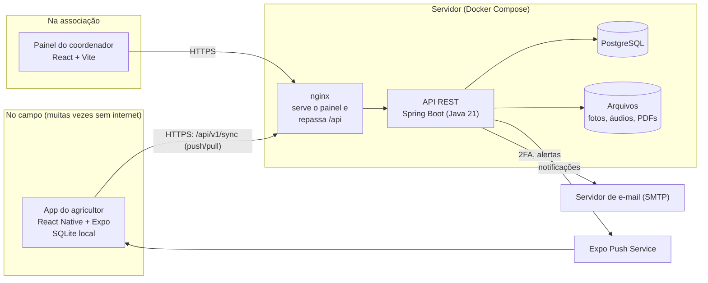
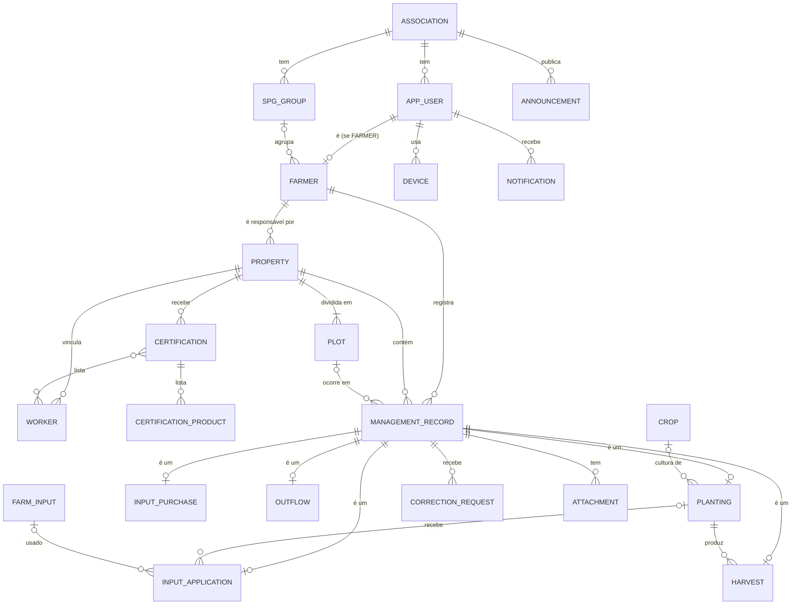
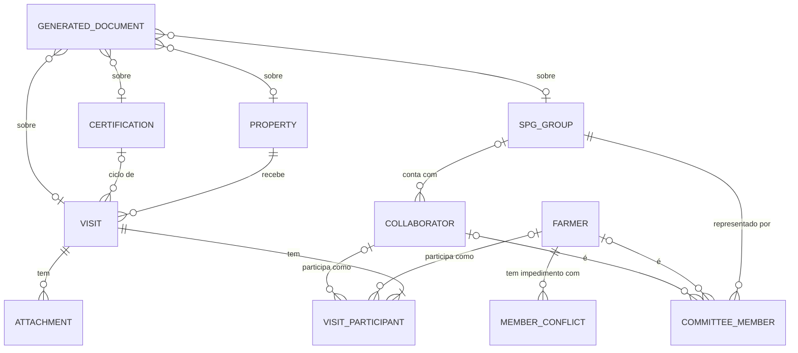
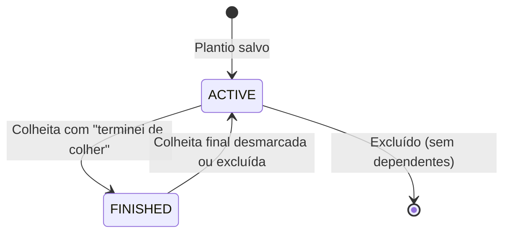
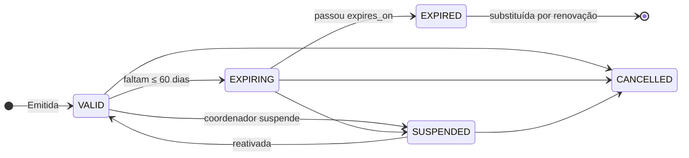
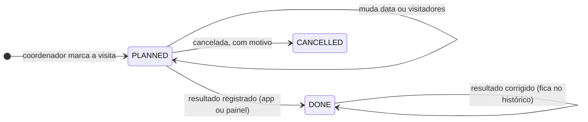
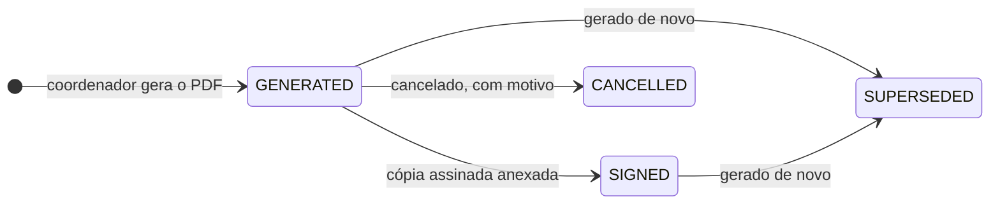

# Agrofácil: arquitetura, domínio e contrato API-front

O Agrofácil é o caderno de campo digital dos agricultores orgânicos de uma cooperativa que certifica pelo Sistema Participativo de Garantia (SPG), como núcleo regional de um OPAC. Ele tem duas partes:

- **um app Android para o agricultor**, que registra o manejo exigido pela Portaria MAPA 52/2021 e funciona sem internet;
- **um painel web para o coordenador da associação**, que acompanha agricultores, propriedades, registros e certificações e organiza as visitas da certificação participativa (SPG).

> **Princípio que orienta todas as decisões:** registrar tem que ser o mais fácil possível para alguém com pouquíssima afinidade com tecnologia. Se uma escolha técnica deixa o registro mais difícil para o agricultor, ela está errada, mesmo que seja "mais correta" para o sistema.

## Os três documentos

| Doc | Arquivo | Para quem | O que tem |
|---|---|---|---|
| 1 | **este** | Toda a equipe | Arquitetura e decisões (ADRs), modelo de domínio e regras de negócio, **contrato API-front**, sincronização offline, segurança e LGPD, **certificação participativa (visitas e documentos)** |
| 2 | [2-guia-api.md](2-guia-api.md) | Back-end | Construção da API em Spring Boot, DDL de referência, ambiente, implantação e backup |
| 3 | [3-guia-front-end.md](3-guia-front-end.md) | Front-end e design | UX do agricultor tela a tela, monorepo, app Expo e painel web |

Material de apoio que já existia:
- os documentos originais: Documento de Visão v3, diagramas de casos de uso e de classes, Guia de Estrutura e o protótipo no Figma.

**Ordem de leitura sugerida:**
1. Todos leem as Partes 1, 2 e 6 deste documento e a UX do agricultor ([doc 3, Parte A](3-guia-front-end.md#parte-a-experiência-do-agricultor-ux)). A UX mostra *o que* o agricultor vê, e isso explica muitas decisões técnicas.
2. Quem faz o back-end lê as Partes 3, 4 e 5 deste documento e o [doc 2](2-guia-api.md).
3. Quem faz o front-end lê as Partes 3, 4 (o mobile) e 5 deste documento e o [doc 3](3-guia-front-end.md).

**Como manter estes documentos:**
- O **contrato ([Parte 3](#parte-3-contrato-api-front))** é a fonte da verdade entre back e front. Mudou um campo? Atualize a [Parte 3](#parte-3-contrato-api-front) **no mesmo pull request** da mudança.
- Decisão nova de arquitetura? Acrescente um ADR em [§1.4](#14-registro-de-decisões-adrs), sem apagar os antigos: marque o antigo como "substituído por ADR-xx".
- Regra de negócio nova? Ela ganha um número RN em [§2.4](#24-regras-de-negócio-rn) e é citada pelo número no código e nos testes (`// RN12`).
- Os itens marcados **[confirmar]** dependem de resposta da associação; a lista consolidada está em [§1.8](#18-pendências-confirmar-com-a-associação). Os marcados **[jurídico]** dependem de um advogado ([Parte 5](#parte-5-segurança-e-lgpd)).
- Referências como "[doc 2 §1.7.4](2-guia-api.md#174-tokens)" apontam para o documento 2, seção 1.7.4.

## Sumário

- **[Parte 1. Arquitetura e decisões](#parte-1-arquitetura-e-decisões)**: [1.1 Visão geral](#11-visão-geral) · [1.2 Stack](#12-stack) · [1.3 Estrutura do repositório](#13-estrutura-do-repositório) · [1.4 Registro de decisões (ADRs)](#14-registro-de-decisões-adrs) · [1.5 Rastreabilidade dos requisitos (Documento de Visão v3)](#15-rastreabilidade-dos-requisitos-documento-de-visão-v3) · [1.6 O que mudou em relação ao diagrama de classes original](#16-o-que-mudou-em-relação-ao-diagrama-de-classes-original) · [1.7 Fora do escopo do MVP](#17-fora-do-escopo-do-mvp) · [1.8 Pendências **[confirmar]** com a associação](#18-pendências-confirmar-com-a-associação)
- **[Parte 2. Modelo de domínio e regras de negócio](#parte-2-modelo-de-domínio-e-regras-de-negócio)**: [2.1 Glossário (português → código)](#21-glossário-português--código) · [2.2 Diagrama entidade-relacionamento](#22-diagrama-entidade-relacionamento) · [2.3 Entidades](#23-entidades) · [2.4 Regras de negócio (RN)](#24-regras-de-negócio-rn) · [2.5 Completude dos registros](#25-completude-dos-registros) · [2.6 Ciclos de vida](#26-ciclos-de-vida) · [2.7 Índices e desempenho](#27-índices-e-desempenho)
- **[Parte 3. Contrato API-front](#parte-3-contrato-api-front)**: [3.1 Convenções gerais](#31-convenções-gerais) · [3.2 Formatos comuns](#32-formatos-comuns) · [3.3 Autenticação](#33-autenticação) · [3.4 Perfil (`/me`)](#34-perfil-me) · [3.5 Sincronização (app do agricultor)](#35-sincronização-app-do-agricultor) · [3.6 Arquivos (fotos, áudios, PDFs)](#36-arquivos-fotos-áudios-pdfs) · [3.7 Associação, coordenadores, grupos, agricultores e aparelhos (painel)](#37-associação-coordenadores-grupos-agricultores-e-aparelhos-painel) · [3.8 Propriedades, áreas e trabalhadores](#38-propriedades-áreas-e-trabalhadores) · [3.9 Registros de manejo](#39-registros-de-manejo) · [3.10 Certificações](#310-certificações) · [3.11 Painel inicial (RF19)](#311-painel-inicial-rf19) · [3.12 Comunicados e notificações](#312-comunicados-e-notificações) · [3.13 Catálogos e municípios](#313-catálogos-e-municípios) · [3.14 Relatórios](#314-relatórios) · [3.15 Visitas do SPG](#315-visitas-do-spg) · [3.16 Documentos gerados](#316-documentos-gerados) · [3.17 Matriz de permissões](#317-matriz-de-permissões) · [3.18 Códigos de erro (`code`)](#318-códigos-de-erro-code) · [3.19 Exemplo completo: colheita registrada no campo](#319-exemplo-completo-colheita-registrada-no-campo)
- **[Parte 4. Sincronização offline](#parte-4-sincronização-offline)**: [4.1 Modelo mental](#41-modelo-mental) · [4.2 Banco local (SQLite)](#42-banco-local-sqlite) · [4.3 Escritas locais](#43-escritas-locais) · [4.4 O ciclo de sincronização](#44-o-ciclo-de-sincronização) · [4.5 Estados que o agricultor vê](#45-estados-que-o-agricultor-vê) · [4.6 Sessão expirada ou aparelho revogado](#46-sessão-expirada-ou-aparelho-revogado) · [4.7 Servidor: como o push é processado](#47-servidor-como-o-push-é-processado) · [4.8 Servidor: como o pull é calculado](#48-servidor-como-o-pull-é-calculado) · [4.9 Casos de teste obrigatórios](#49-casos-de-teste-obrigatórios)
- **[Parte 5. Segurança e LGPD](#parte-5-segurança-e-lgpd)**: [5.1 O que estamos protegendo](#51-o-que-estamos-protegendo) · [5.2 Ameaças e controles](#52-ameaças-e-controles) · [5.3 Dados no celular](#53-dados-no-celular) · [5.4 Logs](#54-logs) · [5.5 Termo de uso e aviso de privacidade (RNF06)](#55-termo-de-uso-e-aviso-de-privacidade-rnf06) · [5.6 Mapa de dados pessoais (LGPD art. 37)](#56-mapa-de-dados-pessoais-lgpd-art-37) · [5.7 Retenção, eliminação e anonimização](#57-retenção-eliminação-e-anonimização) · [5.8 Direitos dos titulares (art. 18): como atender](#58-direitos-dos-titulares-art-18-como-atender) · [5.9 Incidentes de segurança](#59-incidentes-de-segurança) · [5.10 Papéis](#510-papéis) · [5.11 Riscos residuais](#511-riscos-residuais) · [5.12 Checklist de segurança antes de usar com dados reais](#512-checklist-de-segurança-antes-de-usar-com-dados-reais)
- **[Parte 6. Certificação participativa (SPG): visitas e documentos](#parte-6-certificação-participativa-spg-visitas-e-documentos)**: [6.1 Como o SPG funciona](#61-como-o-spg-funciona) · [6.2 Princípios](#62-princípios) · [6.3 Ciclo de avaliação e período de visitas](#63-ciclo-de-avaliação-e-período-de-visitas) · [6.4 Sugestão de visitadores](#64-sugestão-de-visitadores) · [6.5 Registro da visita: papel ou app](#65-registro-da-visita-papel-ou-app) · [6.6 Roteiro da visita (modelo `IN19-v1`)](#66-roteiro-da-visita-modelo-in19-v1) · [6.7 Documentos gerados: regras comuns](#67-documentos-gerados-regras-comuns) · [6.8 Modelos dos documentos (`IN19-v1`)](#68-modelos-dos-documentos-in19-v1) · [6.9 Fora da 1ª versão](#69-fora-da-1ª-versão)

## Parte 1. Arquitetura e decisões

### 1.1 Visão geral



Os dois clientes são diferentes de propósito:

| | App do agricultor | Painel do coordenador |
|---|---|---|
| Plataforma | Android (React Native + Expo); iOS fica possível mais tarde | Navegador no computador (desktop-first) |
| Conectividade | **Offline-first**: tudo é salvo no celular e sincronizado depois | Online: consulta a API direto |
| Fonte dos dados na tela | O banco **local** (SQLite) | A API (com cache do TanStack Query) |
| Login | CPF + código de acesso uma vez por aparelho; depois digital ou bloqueio de tela opcional | E-mail + senha + código por e-mail (2FA) |
| Como fala com a API | `/sync/push` e `/sync/pull`, mais autenticação e upload de arquivos | Endpoints REST de cada recurso |

### 1.2 Stack

| Camada | Escolha | Por quê |
|---|---|---|
| API | **Java 21 LTS + Spring Boot 4.1 + Maven** | Pedido da equipe. As versões estão fixadas no `api/pom.xml` |
| Persistência | Spring Data JPA (Hibernate), **Flyway**, **Hibernate Envers** | Migrações versionadas. O Envers guarda o histórico de alterações sem código manual |
| Banco | **PostgreSQL 17** | Pedido da equipe |
| Segurança | Spring Security, JWT de acesso + refresh token opaco e rotativo, Argon2id | Ver [Parte 5](#parte-5-segurança-e-lgpd) |
| Documentação da API | springdoc-openapi (Swagger UI) | Gera o `openapi.json`, de onde saem os tipos TypeScript |
| Relatórios | Thymeleaf + openhtmltopdf (PDF); CSV gerado à mão | Caderno de campo em PDF e planilhas que abrem no Excel |
| App mobile | **Expo (SDK estável mais recente) + React Native + TypeScript** | Um código só, acesso fácil a câmera, GPS, digital, notificações e SQLite |
| Banco local | expo-sqlite + Drizzle ORM | Consultas tipadas, migrações locais e `useLiveQuery` para a tela se atualizar sozinha |
| Painel web | **React + Vite + TypeScript**, Mantine UI, TanStack Query, React Router | O Mantine já traz tabela, formulário, datas, gráficos e notificações prontos para desktop |
| Formulários (ambos) | react-hook-form + zod | Os mesmos esquemas de validação nos dois apps |
| Mapas (web) | Leaflet + react-leaflet + OpenStreetMap | Gratuito e sem chave de API |
| Monorepo JS | pnpm 12 workspaces (via Corepack) | Compartilha tipos e regras entre o mobile e o web |
| Infra | Docker Compose (API, Postgres, nginx, Mailpit em dev) + túnel HTTPS | Roda no computador da equipe. Ver [doc 2, Parte 3](2-guia-api.md#parte-3-ambiente-e-implantação) |

### 1.3 Estrutura do repositório

```text
agrofacil/
├── api/                      # Spring Boot (Maven), independente do pnpm
│   ├── pom.xml
│   └── src/...
├── apps/
│   ├── mobile/               # Expo / React Native (app do agricultor)
│   └── web/                  # Vite / React (painel do coordenador)
├── packages/
│   ├── api-types/            # tipos gerados do openapi.json (não editar à mão)
│   └── domain/               # regras puras compartilhadas: completude, unidades, rótulos pt-BR, esquemas zod
├── infra/
│   ├── docker-compose.yml
│   ├── nginx/
│   └── backup/
├── documentacao/             # estes arquivos .md e a pesquisa de certificação
├── .github/workflows/ci.yml  # CI: ./mvnw verify + lint, typecheck e testes do pnpm
├── .editorconfig
├── pnpm-workspace.yaml
└── package.json              # scripts de conveniência (gerar tipos, lint de tudo)
```

### 1.4 Registro de decisões (ADRs)

Cada ADR tem **contexto → decisão → consequências**. Os antigos nunca são apagados.

#### ADR-01: Monorepo com a API fora do workspace JS
- **Contexto:** o mobile e o web usam os mesmos tipos e regras (completude, conversão de unidades, rótulos). Em repositórios separados, esse código seria copiado e divergiria.
- **Decisão:** um repositório só. Os apps JS ficam num workspace pnpm. A API Maven fica em `api/` e não participa do pnpm.
- **Consequências:** um PR pode mudar API, contrato e telas juntos. O CI precisa de dois jobs (Maven e pnpm).

#### ADR-02: App do agricultor offline-first
- **Contexto:** a internet no campo, na região atendida, é instável. Se o registro falhar uma vez por falta de sinal, o agricultor desiste.
- **Decisão:** o app grava **tudo primeiro no SQLite**, com UUID gerado no aparelho, e uma fila envia depois (`/sync/push`). As telas leem só o banco local. Os dados do servidor chegam por `/sync/pull`.
- **Consequências:** o app nunca mostra "erro de conexão" ao salvar. É preciso tratar idempotência e conflitos ([Parte 4](#parte-4-sincronização-offline)). O painel web continua online, o que é mais simples.

#### ADR-03: Login do agricultor por CPF + código de acesso, sem senha
- **Contexto:** senha é a maior barreira para o público. O protótipo tinha e-mail e senha, auto-cadastro e recuperação por e-mail. Muitos agricultores não usam e-mail.
- **Decisão:**
  - O coordenador cadastra o agricultor e gera um **código de 6 dígitos**: uso único, válido por 72 h, bloqueado após 5 erros.
  - O agricultor digita CPF + código **uma vez por aparelho**. O aparelho recebe um refresh token de longa duração (renovação deslizante de 180 dias), guardado no SecureStore.
  - A digital, ou o bloqueio de tela do próprio celular, é **opcional** para abrir o app.
  - Saiu do app ou trocou de celular? Pede um novo código.
- **Consequências:**
  - Somem as telas de cadastro, senha e "esqueci a senha" do app.
  - O coordenador vira o canal de recuperação e passa a ver e revogar os aparelhos de cada agricultor.
  - RF01 e RF02 são reinterpretados (ver [§1.5](#15-rastreabilidade-dos-requisitos-documento-de-visão-v3)).

#### ADR-04: Coordenador com e-mail + senha + 2FA por e-mail
- **Decisão:** senha com Argon2id. Depois da senha, um código de 6 dígitos enviado por e-mail (RF03). Coordenadores entram por convite de outro coordenador. O primeiro coordenador é criado por variável de ambiente na primeira subida.
- **Consequências:** é preciso um SMTP (Mailpit em desenvolvimento, Gmail ou outro provedor em produção).

#### ADR-05: Plantio como âncora dos registros, dentro de Áreas
- **Contexto:** no protótipo, Aplicação e Colheita apontam para um "Plantio associado", e o Lote nunca aparece. A Portaria 52 (arts. 17, 19, 21 e 22) trata conversão e produção paralela **por área**.
- **Decisão:**
  - A hierarquia é `Propriedade → Área (Plot) → Plantio`, com Aplicação e Colheita apontando para o Plantio.
  - A Área tem status: orgânica, em conversão, não orgânica ou a definir.
  - **O coordenador cadastra as Áreas.** Ao criar uma propriedade, o sistema cria uma "Área principal".
  - Quando há uma Área só, o app **pula** a escolha.
- **Consequências:** o agricultor continua vendo só "Plantio", e a certificação ganha o dado por área de que precisa.

#### ADR-06: Registros com o mínimo obrigatório e completude calculada
- **Decisão:**
  - Cada tipo de registro tem poucos campos **obrigatórios para salvar** e alguns **recomendados**.
  - O sistema calcula `COMPLETE` ou `INCOMPLETE` e lista o que falta. Esse é o selo "Completo" do protótipo.
  - **Não há aprovação do coordenador.** Ele pode abrir um **pedido de correção**.
- **Consequências:** o registro nunca fica travado esperando alguém. A regra de completude existe no servidor (fonte da verdade) e no pacote `domain` (para mostrar offline) e precisa de testes iguais nos dois lados.

#### ADR-07: Catálogos com "Outro"
- **Decisão:**
  - Culturas, insumos e unidades vêm de catálogos mantidos pelo coordenador. Os insumos são semeados a partir dos Anexos V e VII da Portaria 52.
  - Sempre existe a opção **"Outro"**, de texto livre.
  - O painel tem uma tela para o coordenador **associar** os textos livres a itens do catálogo.
- **Consequências:** relatórios agregáveis sem travar o agricultor.

#### ADR-08: Último a enviar vence, com histórico completo
- **Contexto:** o mesmo registro pode ser editado offline pelo agricultor e online pelo coordenador. Uma tela de resolução de conflito é inviável para o público.
- **Decisão:**
  - A versão que **chega por último ao servidor** vence.
  - Toda versão anterior fica no histórico (Envers), então nada se perde.
  - Se um agricultor sobrescrever uma correção do coordenador, o coordenador é notificado.
- **Consequências:** é simples para o agricultor. O coordenador resolve casos raros olhando o histórico.

#### ADR-09: Ordem de sincronização garantida por lock consultivo
- **Contexto:** o pull incremental usa um contador global (`sync_seq`). Transações concorrentes podem fazer commit fora da ordem do contador, e uma mudança passaria despercebida.
- **Decisão:** o trigger que atribui `sync_seq` pega um `pg_advisory_xact_lock`, o que serializa as escritas sincronizáveis. Com dezenas de usuários, o custo é desprezível.
- **Consequências:** o pull fica correto com uma consulta simples. Se o sistema crescer muito, troque por `xid8`/snapshot ([§4.8](#48-servidor-como-o-pull-é-calculado)).

#### ADR-10: Exclusão lógica e histórico em tudo que vira prova
- **Decisão:**
  - Propriedade, área, trabalhador, certificação e registros têm `deleted_at` e são auditados pelo Envers.
  - Nada disso é apagado fisicamente antes do prazo de guarda: pelo menos 3 anos (art. 11, §2º da Portaria 52).
- **Consequências:** as consultas sempre filtram `deleted_at IS NULL`. O pull envia "lápides" (registros excluídos) para os aparelhos apagarem a cópia local.

#### ADR-11: Comunicados e dicas na mesma entidade
- **Decisão:**
  - `Announcement` tem tipo `NOTICE` (aviso) ou `TIP` (dica), escrito pelo coordenador e enviado a todos ou a um grupo do SPG.
  - Vira notificação no app (push + lista de avisos).
  - Contato com a associação = link `wa.me` para o WhatsApp da associação.
- **Consequências:** não há sistema de conteúdo nem chat dentro do app.

#### ADR-12: Áreas em m² internamente, "tarefa" como unidade
- **Decisão:**
  - Toda área é guardada como foi digitada (valor + unidade) **e** convertida para m² (`*_m2`), que é usado nos relatórios.
  - Unidades: hectare, m² e **tarefa**. O tamanho da tarefa é configurável por associação; o padrão é 4.356 m², a tarefa baiana **[confirmar]**.
  - Quantidades (kg, caixa, molho, saco…) **não** são convertidas entre si: os relatórios agrupam por unidade.
- **Consequências:** atende a RNF09 (adaptar à associação) sem forçar o agricultor a pensar em hectare.

#### ADR-13: Tipos TypeScript gerados a partir da API
- **Decisão:**
  - A API publica o OpenAPI (springdoc).
  - O script `pnpm gen:api` baixa o `openapi.json`, salva em `packages/api-types` (versionado no git) e gera os tipos com `openapi-typescript`.
  - Os clientes usam `openapi-fetch`.
- **Consequências:** se a API mudar um campo, o front deixa de compilar, em vez de quebrar em produção. A [Parte 3](#parte-3-contrato-api-front) continua sendo a referência legível e as regras que o OpenAPI não expressa.

#### ADR-14: Sem super-admin por enquanto, mas com o banco pronto para várias associações
- **Decisão:**
  - As tabelas principais têm `association_id`.
  - A associação é criada por migração (dados iniciais), com nome provisório que o coordenador troca no painel.
  - Não há tela de super-admin.
- **Consequências:** atender uma segunda associação no futuro exige só uma migração ou um script, não remodelar o banco.

#### ADR-15: Visitas do SPG: o sistema prepara, sugere e lembra; as pessoas decidem
- **Contexto:**
  - A equipe adotou formalmente a certificação participativa (SPG), em que a garantia vem do controle social (IN 19/2009, art. 69).
  - Quem visita e o que se conclui são decididos pelo grupo e pela Comissão de Avaliação, em reunião (art. 84). Um sistema que "decide" tiraria a legitimidade do processo.
- **Decisão:**
  - O Agrofácil calcula o período de visitas, **sugere** visitadores com os motivos, lembra as pessoas, guarda o resultado e gera os documentos.
  - A escolha final dos visitadores é do coordenador, depois de combinar com o grupo.
  - Nenhum documento sai com a decisão de conformidade preenchida.
  - Só o coordenador opera as telas do SPG no painel. Os visitadores participam pelo app.
- **Consequências:**
  - Não existe regra automática de aprovação.
  - As telas falam em "sugestão" e mostram o "motivo".
  - Reunião e ata continuam fora do sistema na 1ª versão ([§6.9](#69-fora-da-1ª-versão)).

#### ADR-16: Visita registrada no papel ou no app, com o mesmo resultado
- **Contexto:** os visitadores também são agricultores com pouca afinidade com tecnologia, e alguns grupos podem preferir o papel.
- **Decisão:** há dois caminhos, que gravam o mesmo `VisitResult`:
  1. o **"modo visita" no app**, que funciona sem internet e é usado só pelo **responsável pelo registro** escolhido na visita;
  2. o **roteiro impresso já preenchido**, que o coordenador digita depois no painel, anexando a foto da folha.
- **Consequências:**
  - Um único responsável evita conflito entre dois celulares.
  - O papel funciona mesmo que ninguém do grupo use o app.

#### ADR-17: Resumo da visita em vez de sincronizar os registros de outro agricultor
- **Contexto:** o visitador precisa saber o que foi registrado na roça visitada (art. 79), mas o app foi feito para guardar só os dados do próprio agricultor.
- **Decisão:**
  - O servidor monta um **resumo** (`brief`) com o essencial: áreas, plantios ativos e insumos, compras, colheitas e vendas dos últimos 12 meses.
  - O resumo vai só para os participantes da visita, enquanto ela estiver marcada e até 30 dias depois.
- **Consequências:**
  - O espelho local do app continua simples.
  - Fica menos dado pessoal de terceiros no celular (LGPD, necessidade).
  - O visitador não navega nos registros do outro, só no resumo.

#### ADR-18: Documentos em PDF para assinatura no papel, com modelo versionado
- **Contexto:**
  - Quem assina os documentos do SPG são agricultores, muitos sem certificado digital.
  - A forma dos documentos é definida pelo manual do OPAC (art. 73), e ainda não temos os modelos oficiais do OPAC.
- **Decisão:**
  - PDFs gerados no servidor, como o caderno de campo, com linha de assinatura (ou digital) para cada pessoa, código de verificação e hash.
  - Os modelos têm versão. A primeira é `IN19-v1`, baseada na IN 19/2009. Os modelos oficiais entram como versão nova, sem apagar os documentos antigos.
  - A cópia assinada é fotografada e anexada.
- **Consequências:**
  - Funciona na reunião sem internet, porque é papel.
  - A assinatura eletrônica (gov.br) pode vir depois sem mudar o modelo de dados.

### 1.5 Rastreabilidade dos requisitos (Documento de Visão v3)

| Req. | Como é atendido | Onde |
|---|---|---|
| RF01 | **Reinterpretado:** CPF + código de acesso por aparelho (ADR-03), no lugar de e-mail e senha | [§3.3](#33-autenticação), [doc 3 §A.3](3-guia-front-end.md#a3-primeiro-acesso-ativação) |
| RF02 | **Reinterpretado:** a recuperação é um novo código pedido ao coordenador. Para coordenadores, há link de redefinição por e-mail | [§3.3](#33-autenticação) |
| RF03 | 2FA por código no e-mail para coordenadores | ADR-04, [§3.3](#33-autenticação) |
| RF04–RF09 | O agricultor cria, edita e exclui (logicamente) propriedades no app; o coordenador também, no painel. A exclusão pede confirmação | [§2.4](#24-regras-de-negócio-rn) RN06–RN08, [doc 3 §A.6](3-guia-front-end.md#a6-propriedades-rf04rf09) |
| RF10 | GPS capturado ao abrir qualquer formulário de registro (opcional se negado) | [§2.4](#24-regras-de-negócio-rn) RN26, [doc 3 §C.7](3-guia-front-end.md#c7-gps-foto-áudio-e-voz) |
| RF11 | Validação no app (zod) **e** na API (Bean Validation + regras de negócio) | [§3.2.5](#325-erros), [doc 2 §1.8](2-guia-api.md#18-validação-e-erros) |
| RF12 | Registro "Usei adubo ou remédio" (`INPUT_APPLICATION`) | [Parte 2](#parte-2-modelo-de-domínio-e-regras-de-negócio), [doc 3 §A.5](3-guia-front-end.md#a5-fluxos-de-registro) |
| RF13–RF14 | SQLite local + sincronização automática | [Parte 4](#parte-4-sincronização-offline) |
| RF15–RF17 | Telas de Agricultores, Propriedades e Certificações do painel | [doc 3 §D](3-guia-front-end.md#parte-d-painel-do-coordenador-vite--react) |
| RF18 | Rotina diária de alertas (60/30/15 dias e no vencimento) por push, aviso no app e e-mail | [§2.4](#24-regras-de-negócio-rn) RN20, [doc 2 §1.12](2-guia-api.md#112-rotinas-notificações-push-e-e-mail) |
| RF19 | Painel inicial com gráficos de status, atualizado a cada minuto | [§3.11](#311-painel-inicial-rf19), [doc 3 §D](3-guia-front-end.md#parte-d-painel-do-coordenador-vite--react) |
| RNF01, RNF10 | Segurança e LGPD | [Parte 5](#parte-5-segurança-e-lgpd) |
| RNF03 | Telas do app leem SQLite local; o painel pagina tudo; índices no banco | [§2.7](#27-índices-e-desempenho), [doc 2](2-guia-api.md) |
| RNF04, RNF08, RNF12 | Guia de UX | [doc 3, Parte A](3-guia-front-end.md#parte-a-experiência-do-agricultor-ux) |
| RNF05, RNF13 | Postgres + exclusão lógica + histórico + backup | ADR-10, [doc 2, Parte 3](2-guia-api.md#parte-3-ambiente-e-implantação) |
| RNF06 | Termo de uso e aviso de privacidade na ativação do app | [§5.5](#55-termo-de-uso-e-aviso-de-privacidade-rnf06) |
| RNF07 | Fora do alcance de um computador próprio. O offline-first reduz o impacto para o agricultor | [doc 2, Parte 3](2-guia-api.md#parte-3-ambiente-e-implantação) |
| RNF09 | Configurações por associação: tarefa, dias de alerta, catálogos | ADR-12, [Parte 2](#parte-2-modelo-de-domínio-e-regras-de-negócio) |
| RNF11 | Offline-first | ADR-02, [Parte 4](#parte-4-sincronização-offline) |
| — (pedido da equipe, 11/2026) | Certificação participativa: período de visitas, sugestão de visitadores, registro da visita (papel ou app) e documentos prontos para assinar | ADR-15 a ADR-18, [Parte 6](#parte-6-certificação-participativa-spg-visitas-e-documentos) |

### 1.6 O que mudou em relação ao diagrama de classes original

| Diagrama original | Agora | Motivo |
|---|---|---|
| `Agricultor.senha`, `email` obrigatório | Sem senha. E-mail opcional | ADR-03 |
| `Agricultor.dataNascimento` | **Removido** | Não é necessário para a finalidade (LGPD, necessidade). Volta se a associação pedir |
| `Localizacao` → `Bairro` → `Cidade` → `Estado` | Campos de endereço + `municipality` (código IBGE) | Menos tabelas; "Bairro/Distrito/Povoado" vira texto livre (`locality`) |
| `Lote` | `Plot` (Área), com status de conversão | ADR-05 |
| `Manejo` (superclasse) | `ManagementRecord` (herança JOINED) | Igual ao diagrama |
| `Plantio`, `Aplicação`, `Colheita` | `Planting`, `InputApplication`, `Harvest` | Aplicação e colheita apontam para o plantio |
| — | `InputPurchase`, `Outflow` (novos) | Exigidos pela Portaria 52, art. 11 |
| `Insumo` → `Material` | `FarmInput` com `inputType` | "Material" foi interpretado como o tipo do insumo |
| `Cultivar` → `Categoria` | `Crop` → `CropCategory`; a variedade é texto no plantio | |
| `Colheita` → `Unidade` | `MeasurementUnit`, usada por todos os registros | |
| `Equipamento` | **Fora do MVP** | Não é exigido para os registros e aumentaria o formulário |
| `Grupo` | `SpgGroup` | É o grupo do SPG |
| `Trabalhadores` | `Worker`, ligado à propriedade e listado na certificação | |
| — | `Certification`, `Announcement`, `CorrectionRequest`, `Attachment`, `Device`, `Notification` | Novas necessidades |
| — | `Visit`, `VisitParticipant`, `VisitChecklistItem`, `Collaborator`, `CommitteeMember`, `MemberConflict`, `GeneratedDocument` | Certificação participativa ([Parte 6](#parte-6-certificação-participativa-spg-visitas-e-documentos)) |

### 1.7 Fora do escopo do MVP

- Emissão oficial do certificado. O sistema gera o **modelo** e quem emite e assina é o OPAC.
- Reuniões do grupo, presença e atas; não conformidades com prazos, acompanhamento e recursos. Veja a [§6.9](#69-fora-da-1ª-versão).
- Assinatura eletrônica dos documentos do SPG. Os documentos são assinados no papel (ADR-18).
- Integração com CNPO, SigOrgWeb e AgroRastro. Existe exportação em CSV.
- Plano de Manejo Orgânico estruturado: no MVP, é só um PDF anexado à propriedade.
- Produção animal e apicultura.
- Módulos financeiros.
- App para iOS. O código Expo permite gerar depois.
- Chat dentro do app.

### 1.8 Pendências **[confirmar]** com a associação

1. Tamanho da "tarefa" usado na região (o padrão é 4.356 m²).
2. Unidades de quantidade mais usadas (caixa, molho, saco, kg…) e o peso aproximado de uma caixa de cada produto, se quiserem relatórios em kg.
3. Lista inicial de culturas e de insumos caseiros (biofertilizante, calda, composto…).
4. O certificado tem número? Há um modelo em PDF para anexar?
5. Dias de antecedência dos alertas (padrão: 60, 30 e 15).
6. Quanto tempo guardar os dados depois que o agricultor sai da associação. O mínimo legal é 3 anos; o padrão proposto é 5.
7. Quais destinos de venda usam: feira, cooperativa, PNAE, PAA, atravessador…
8. As 8 perguntas sobre o funcionamento do núcleo levantadas na pesquisa de certificação da equipe (mantida fora do repositório).
9. **Manual de procedimentos do OPAC:**
   - o roteiro mínimo das visitas;
   - os itens do relatório;
   - a **periodicidade mínima das visitas de pares** (o padrão do sistema é 2 por ano);
   - se usam **amostragem** na verificação.
10. **Modelos oficiais** para substituir os modelos `IN19-v1` ([§6.8](#68-modelos-dos-documentos-in19-v1)): requerimento de adesão, roteiro, relatório, registro de visita de pares, documento de aprovação e certificado.
11. **Visitas:**
    - quantos visitadores por visita (padrão 2);
    - se um membro da Comissão pode verificar uma propriedade do próprio grupo (padrão: não);
    - com quantos dias de antecedência abre o período de visitas (padrão 90).
12. **Pessoas do SPG:**
    - quem são os titulares e suplentes da Comissão de Avaliação;
    - quais técnicos e consumidores participam de cada grupo;
    - quais impedimentos entre membros (parentes, sócios) devem ser cadastrados.

## Parte 2. Modelo de domínio e regras de negócio

Esta parte define **o que existe no sistema** e **quais regras valem**. Os nomes no código e no banco são em inglês; o glossário traduz cada um.

### 2.1 Glossário (português → código)

| Termo no app / na associação | Classe Java | Tabela | Observação |
|---|---|---|---|
| Associação (Núcleo / Coop) | `Association` | `association` | Associação única (nome definido no painel) |
| Grupo (do SPG) | `SpgGroup` | `spg_group` | Grupo de pelo menos 3 agricultores que fazem visitas de pares |
| Usuário | `AppUser` | `app_user` | Agricultor ou coordenador |
| Agricultor | `Farmer` | `farmer` | Perfil que estende `app_user` |
| Coordenador | `AppUser` com `role = COORDINATOR` | `app_user` | Não tem tabela de perfil |
| Município | `Municipality` | `municipality` | Código IBGE |
| Propriedade (unidade de produção) | `Property` | `property` | Recebe a certificação |
| Área (lote, talhão, canteiro, roça) | `Plot` | `plot` | Tem status de conversão |
| Trabalhador / pessoa vinculada | `Worker` | `worker` | Família ou empregados, listados no certificado |
| Certificação | `Certification` | `certification` | Uma por emissão; renovação = nova linha |
| Registro de manejo | `ManagementRecord` | `management_record` | Superclasse |
| Plantio | `Planting` | `planting` | Ciclo de uma cultura numa área |
| Aplicação de insumo ("Usei adubo ou remédio") | `InputApplication` | `input_application` | |
| Colheita | `Harvest` | `harvest` | |
| Compra de insumo | `InputPurchase` | `input_purchase` | |
| Saída / venda ("Vendi ou entreguei") | `Outflow` | `outflow` | |
| Cultura | `Crop` | `crop` | Alface, feijão, umbu… |
| Categoria de cultura | `CropCategory` | `crop_category` | Hortaliça, fruta, grão… |
| Insumo | `FarmInput` | `farm_input` | Adubo, calda, biofertilizante… |
| Unidade de medida | `MeasurementUnit` | `measurement_unit` | kg, caixa, tarefa… |
| Anexo (foto, áudio, PDF) | `Attachment` | `attachment` | |
| Pedido de correção | `CorrectionRequest` | `correction_request` | Do coordenador para um registro |
| Comunicado / dica | `Announcement` | `announcement` | |
| Notificação | `Notification` | `notification` | Por usuário |
| Aparelho | `Device` | `device` | Celular vinculado ao agricultor |
| Código de acesso | `AccessCode` | `access_code` | Para ativar um aparelho |
| Visita de pares ("visita do grupo") / de verificação ("visita da comissão") | `Visit` | `visit` | `type` = `PEER` ou `VERIFICATION` |
| Visitador / observador | `VisitParticipant` | `visit_participant` | Agricultor ou colaborador numa visita |
| Pergunta do roteiro da visita | `VisitChecklistItem` | `visit_checklist_item` | Modelo `IN19-v1` ([§6.6](#66-roteiro-da-visita-modelo-in19-v1)) |
| Colaborador do SPG (técnico, consumidor) | `Collaborator` | `collaborator` | Participa sem login |
| Membro da Comissão de Avaliação | `CommitteeMember` | `committee_member` | Titular ou suplente, representando um grupo |
| Impedimento entre membros | `MemberConflict` | `member_conflict` | Parentes, mesma casa ou sócios não visitam um ao outro |
| Documento gerado | `GeneratedDocument` | `generated_document` | PDF pronto para assinar |

### 2.2 Diagrama entidade-relacionamento



Certificação participativa (SPG), [Parte 6](#parte-6-certificação-participativa-spg-visitas-e-documentos):



Fluxo principal visto pelo agricultor:

```text
Propriedade "Sítio Boa Vista"
 └── Área "Horta de baixo" (orgânica)              ← o coordenador cadastra
      └── Plantio: alface, 24/10, 1 tarefa          ← "Plantei"
           ├── Aplicação: biofertilizante, 2 L      ← "Usei adubo ou remédio"
           ├── Colheita: 30 molhos, 20/11           ← "Colhi"
           └── Colheita: 25 molhos, 27/11 (final)   ← "Colhi" + "Terminei de colher"
Saída: 50 molhos de alface → feira, 28/11           ← "Vendi ou entreguei"
Compra: 2 sacos de esterco, 10/10                   ← "Comprei insumo"
```

### 2.3 Entidades

As colunas comuns aparecem uma vez aqui e valem para todas as tabelas marcadas com **[S]** (sincronizável) ou **[A]** (auditada):

| Coluna | Tipo | Significado |
|---|---|---|
| `id` | `uuid` | Gerado **no cliente** para o que o app cria offline; senão, pelo servidor |
| `created_at`, `updated_at` | `timestamptz` | Horário do servidor |
| `deleted_at` | `timestamptz` null | Exclusão lógica (ADR-10) |
| `version` | `bigint` | Versão do registro (`@Version` do JPA), começa em 0 |
| `sync_seq` | `bigint` | Preenchido por trigger a cada escrita; é a ordem usada no pull ([Parte 4](#parte-4-sincronização-offline)) |

#### 2.3.1 Association
`name`, `cnpj`, `email`, `phone`, `whatsapp` (formato E.164, ex.: `+5574999998888`), `opac_name` (nome do OPAC), `tarefa_m2` (padrão 4356), `alert_days` (padrão `{60,30,15}`), `access_code_ttl_hours` (padrão 72), `retention_years` (padrão 5). SPG: `visit_window_days` (padrão 90), `peer_visits_per_year` (padrão 2), `visitors_per_visit` (padrão 2), `visit_reminder_days` (padrão 1; 0 = sem lembrete), `verification_same_group_allowed` (padrão `false`). **[S]**

#### 2.3.2 AppUser e Farmer
- `app_user`: `association_id`, `role` (`FARMER`, `COORDINATOR`), `name`, `cpf` (11 dígitos, sem máscara; obrigatório para agricultor), `email` (obrigatório para coordenador), `phone` (E.164), `password_hash` (só coordenador), `status` (`ACTIVE`, `INACTIVE`), `terms_accepted_at`, `terms_version`, `last_login_at`. **[S] [A]**
- `farmer` (1:1 com `app_user`): `group_id`, `caf_number` (Cadastro da Agricultura Familiar, opcional), `group_joined_year`, endereço (`postal_code`, `uf`, `municipality_id`, `locality`, `street`, `number`, `complement`), `notes`.

#### 2.3.3 SpgGroup
`association_id`, `name`, `municipality_id`, `notes`. **[S] [A]**

#### 2.3.4 Property
`association_id`, `farmer_id`, `name`, `total_area` + `total_area_unit` + `total_area_m2`, `production_description` (texto, ex.: "Hortaliças e frutas"), `latitude`, `longitude`, `location_accuracy_m`, endereço (mesmos campos do agricultor), `access_directions` (roteiro de acesso), `created_by`. **[S] [A]**

#### 2.3.5 Plot
`property_id`, `name`, `area` + `area_unit` + `area_m2`, `status` (`ORGANIC`, `IN_CONVERSION`, `NON_ORGANIC`, `NOT_DEFINED`), `conversion_ends_on`, `notes`. **[S] [A]**

#### 2.3.6 Worker
`property_id`, `name`, `relationship` (`FAMILY`, `EMPLOYEE`, `PARTNER`, `OTHER`), `active`. **[S] [A]**

#### 2.3.7 Certification
- Colunas: `property_id`, `number`, `issued_on`, `expires_on`, `manual_status` (`ACTIVE`, `SUSPENDED`, `CANCELLED`), `status_reason`, `scope` (texto, ex.: "Produção primária vegetal"), `previous_id` (a certificação que esta renova), `notes`, `created_by`. **[S] [A]**
- `certification_product`: `certification_id`, `crop_id` ou `product_name`.
- `certification_worker`: `certification_id`, `worker_id`.
- `certification_alert`: `certification_id`, `days_before`, `sent_at`. Impede alerta repetido.
- O PDF do certificado vai em `attachment` (`owner_type = CERTIFICATION`).

**Status efetivo** (calculado, nunca gravado):

```text
se manual_status = CANCELLED                 → CANCELLED
se manual_status = SUSPENDED                 → SUSPENDED
se hoje > expires_on                         → EXPIRED
se expires_on - hoje <= max(alert_days)      → EXPIRING  (com daysToExpire)
senão                                        → VALID
```

"Hoje" é a data em `America/Bahia`. O protótipo mostra "Certificação regular" para `VALID` e `EXPIRING`, e "irregular" para os outros estados ou sem certificação. O guia de UX troca esses termos por frases mais claras.

**Certificação atual** de uma propriedade: a de maior `issued_on` que não esteja `CANCELLED` nem excluída.

#### 2.3.8 ManagementRecord (superclasse) e subtipos

Herança JPA `JOINED`: a tabela-mãe guarda o que é comum, e cada subtipo tem sua tabela com o mesmo `id`.

| `management_record` | Tipo | Obs. |
|---|---|---|
| `record_type` | texto | `PLANTING`, `INPUT_APPLICATION`, `HARVEST`, `INPUT_PURCHASE`, `OUTFLOW` |
| `record_number` | bigint | Sequência do servidor, mostrada como "Nº 000123". É nula até sincronizar |
| `association_id`, `farmer_id`, `property_id` | uuid | Sempre preenchidos (o servidor deduz quando possível) |
| `plot_id` | uuid null | Obrigatório em plantio e aplicação; nulo em compra e saída |
| `performed_on` | date | Data do plantio, da aplicação, da colheita etc. |
| `notes` | texto ≤ 2000 | |
| `latitude`, `longitude`, `location_accuracy_m`, `location_captured_at` | | GPS ao abrir o formulário (RF10) |
| `device_id` | uuid null | Aparelho de origem |
| `source` | texto | `MOBILE` ou `WEB` |
| `created_by`, `updated_by` | uuid | Quem fez: o agricultor ou o coordenador "em nome de" |
| `client_created_at` | timestamptz | Hora do aparelho quando o registro foi criado |
| `completeness` | texto | `COMPLETE` ou `INCOMPLETE` (calculado pelo servidor a cada escrita, gravado para filtrar) |
| `missing_fields` | text[] | Nomes dos campos recomendados que faltam |

**Planting**: `crop_id` ou `crop_other_name`, `variety`, `planted_area` + `planted_area_unit` + `planted_area_m2`, `propagation_type` (`SEED`, `SEEDLING`, `CUTTING`, `OTHER`), `propagation_quantity` + `propagation_unit`, `seed_origin` (`OWN`, `ORGANIC_PURCHASED`, `CONVENTIONAL_PURCHASED`, `SEED_BANK`), `seed_supplier`, `expected_harvest_on`, `cycle_status` (`ACTIVE`, `FINISHED`), `finished_on`.

**InputApplication**: `planting_id` (nulo quando é na área inteira, ex.: preparo do solo), `input_id` ou `input_other_name`, `purpose` (`FERTILIZATION`, `PEST_DISEASE_CONTROL`, `SOIL_CORRECTION`, `OTHER`), `quantity` + `quantity_unit`, `applied_area` + `applied_area_unit` + `applied_area_m2`.

**Harvest**: `planting_id` (obrigatório), `quantity` + `quantity_unit`, `harvested_area` + `harvested_area_unit` + `harvested_area_m2`, `is_final`.

**InputPurchase**: `input_id` ou `input_other_name`, `quantity` + `quantity_unit`, `supplier`.

**Outflow**: `crop_id` ou `product_other_name`, `planting_id` (opcional), `quantity` + `quantity_unit`, `destination` (`FAIR`, `COOPERATIVE`, `PNAE`, `PAA`, `MIDDLEMAN`, `DIRECT_SALE`, `OWN_CONSUMPTION`, `DONATION`, `OTHER`), `buyer_name`.

#### 2.3.9 Catálogos
- `crop_category`: `name`, `icon`.
- `crop`: `association_id` (nulo = global), `category_id`, `name`, `icon` (chave de ícone do app, ex.: `lettuce`), `active`. **[S]**
- `farm_input`: `association_id`, `name`, `input_type` (`FERTILIZER`, `SOIL_CORRECTIVE`, `BIOFERTILIZER`, `PEST_DISEASE_CONTROL`, `INOCULANT`, `OTHER`), `regulatory_reference` (ex.: "Portaria 52/2021, Anexo V"), `needs_authorization` (o OAC precisa autorizar), `home_made` (feito na propriedade), `active`. **[S]**
- `measurement_unit` (código como chave): `code`, `name_singular`, `name_plural`, `kind` (`AREA`, `MASS`, `VOLUME`, `COUNT`, `PACKAGE`), `to_base_factor` (para m², kg ou L; nulo para `TAREFA`, que usa `association.tarefa_m2`, e para embalagens), `sort_order`, `active`. **[S]**

Unidades iniciais: `HECTARE`, `SQUARE_METER`, `TAREFA`, `KILOGRAM`, `GRAM`, `LITER`, `MILLILITER`, `UNIT`, `BOX` (caixa), `BAG` (saco), `BUNCH` (molho), `DOZEN`, `SEEDLING` (muda), `CAN` (lata), `CART` (carroça) **[confirmar a lista]**.

#### 2.3.10 Apoio
- `attachment`: `association_id`, `owner_type` (`RECORD`, `PROPERTY`, `CERTIFICATION`, `ANNOUNCEMENT`, `VISIT`, `DOCUMENT`), `owner_id`, `kind` (`PHOTO`, `AUDIO`, `DOCUMENT`), `content_type`, `size_bytes`, `sha256`, `storage_key`, `duration_seconds` (áudio), `uploaded_at` (nulo enquanto o arquivo não chegou), `created_by`. **[S]**
- `correction_request`: `record_id`, `message`, `status` (`OPEN`, `RESOLVED`), `created_by`, `resolved_by`, `resolved_at`. **[S]**
- `announcement`: `association_id`, `type` (`NOTICE`, `TIP`), `title`, `body`, `group_id` (nulo = todos), `published_at`, `created_by`. **[S]**
- `notification`: `user_id`, `type`, `title`, `body`, `data` (jsonb, ex.: `{"recordId": "..."}`), `read_at`. **[S]**
- `device`: `user_id`, `name` (ex.: "Samsung A15"), `platform`, `app_version`, `push_token`, `last_seen_at`, `revoked_at`, `revoked_by`.
- `refresh_token`: `user_id`, `device_id` (nulo no web), `family_id`, `token_hash`, `expires_at`, `used_at`, `revoked_at`.
- `access_code`: `farmer_id`, `code_hash`, `expires_at`, `failed_attempts`, `used_at`, `revoked_at`, `created_by`.
- `login_challenge`: `user_id`, `code_hash`, `expires_at`, `failed_attempts`, `used_at` (2FA do coordenador).
- `user_token`: `user_id`, `purpose` (`PASSWORD_RESET`, `INVITE`), `token_hash`, `expires_at`, `used_at`.
- `sync_mutation`: `id` (UUID da mutação), `user_id`, `device_id`, `entity`, `entity_id`, `status`, `response` (jsonb), `processed_at`. Garante a idempotência do push.
- `alert_log`: `subject_id`, `alert_key` (ex.: `VISIT_WINDOW_OPEN:<certificationId>`, `VISIT_REMINDER:<visitId>`), `sent_at`. Impede aviso repetido das rotinas do SPG.

#### 2.3.11 Certificação participativa (SPG)
- `collaborator`: `association_id`, `group_id` (nulo = do Núcleo todo), `name`, `kind` (`TECHNICIAN`, `CONSUMER`, `ORGANIZATION`, `OTHER`), `organization`, `phone`, `notes`, `active`. Não tem login. **[A]**
- `committee_member`: `association_id`, `farmer_id` **ou** `collaborator_id`, `represented_group_id`, `role` (`HOLDER` titular, `ALTERNATE` suplente), `started_on`, `ended_on`. **[A]**
- `member_conflict`: `association_id`, `farmer_a_id` e `farmer_b_id` (guardados com `a < b`, para não duplicar), `reason` (`FAMILY`, `SAME_HOUSEHOLD`, `BUSINESS`, `OTHER`), `notes`. Só o coordenador vê. **[A]**
- `visit`: **[S] [A]**
  - identificação: `association_id`, `property_id`, `group_id` (grupo do visitado, copiado ao marcar), `certification_id` (do ciclo; nulo se não houver);
  - agenda: `type` (`PEER`, `VERIFICATION`), `unannounced` (só `VERIFICATION`), `status` (`PLANNED`, `DONE`, `CANCELLED`), `planned_on`, `cancel_reason`;
  - registro: `recorder_participant_id` (o participante agricultor que registra pelo app; nulo = papel);
  - resultado: `done_on`, `answers` (jsonb `[{itemCode, answer, note}]`), `issues_found`, `improvement_points`, `recommendations`, `notes`, `latitude`/`longitude`/`location_accuracy_m` (ao concluir), `result_source` (`MOBILE`, `WEB`), `result_recorded_by`, `result_recorded_at`;
  - resumo: `brief` (jsonb, ADR-17) e `brief_updated_at`;
  - autoria: `created_by`, `updated_by`.
- `visit_participant`: `visit_id`, `farmer_id` **ou** `collaborator_id`, `role` (`VISITOR`, `OBSERVER`), `suggested`, `suggestion_reasons` (text[]), `attended`. Mudar participantes **sempre** atualiza a linha da `visit`, para a mudança chegar ao app. **[A]**
- `visit_checklist_item`: `association_id` (nulo = modelo padrão), `code`, `applies_to` (`PEER`, `VERIFICATION`, `BOTH`), `question`, `formal_text`, `help`, `legal_reference`, `sort_order`, `template_version`, `active`. **[S]**
- `generated_document`: **[A]**
  - tipo e assunto: `association_id`, `kind`, `template_version`, `title`; `farmer_id`, `property_id`, `group_id`, `visit_id`, `certification_id`, `period_from`, `period_to` (os que se aplicam ao tipo);
  - arquivo: `verification_code` (único, 8 caracteres sem letras parecidas), `sha256`, `storage_key`, `size_bytes`;
  - conteúdo: `data_snapshot` (jsonb com os dados usados) e `warnings` (text[]);
  - situação: `status` (`GENERATED`, `SIGNED`, `SUPERSEDED`, `CANCELLED`), `signed_attachment_id`, `superseded_by_id`, `cancel_reason`;
  - autoria: `generated_by`, `generated_at`.

### 2.4 Regras de negócio (RN)

Cite o número no código e nos testes, por exemplo `// RN12`.

**Pessoas e acesso**
- **RN01:** todo agricultor pertence a exatamente uma associação e a no máximo um grupo do SPG. Grupo com menos de 3 agricultores gera **aviso**, não erro.
- **RN02:** o CPF é único entre usuários não excluídos e precisa ter dígitos verificadores válidos. É guardado sem máscara.
- **RN03:** o código de acesso tem 6 dígitos, é de uso único e vale `association.access_code_ttl_hours` (padrão 72 h). Fica inválido após 5 tentativas erradas. Gerar um código novo revoga os anteriores não usados. Só o coordenador gera.
- **RN04:** a sessão do agricultor dura enquanto o aparelho usar o app. O refresh token é renovado a cada uso, expira após **180 dias sem uso** e muda a cada renovação (rotação). Reutilizar um token já trocado revoga a família inteira, por suspeita de roubo. Revogar o aparelho revoga seus tokens.
- **RN05:** a senha do coordenador tem no mínimo 10 caracteres e não pode estar entre as mais comuns. O código 2FA tem 6 dígitos, vale 10 min e aceita 5 tentativas. A sessão web expira após 12 h sem uso, com no máximo 7 dias.
- **RN25:** agricultor `INACTIVE` não ativa aparelhos e tem os aparelhos revogados. Os dados continuam guardados (RN15).
- **RN24:** não é possível desativar o último coordenador ativo da associação.

**Propriedades e áreas**
- **RN06:** o agricultor e o coordenador podem criar e editar propriedades. Ao criar uma propriedade, o sistema cria uma Área "Área principal", com a mesma área total e status `NOT_DEFINED`.
- **RN07:** excluir uma propriedade é exclusão lógica, sempre com confirmação (RF09). Fica **bloqueado** se houver certificação `VALID` ou `EXPIRING` (erro `PROPERTY_HAS_ACTIVE_CERTIFICATION`). Os registros continuam guardados e visíveis ao coordenador.
- **RN08:** só o coordenador cria, edita e exclui Áreas e define o status de conversão. Uma propriedade tem sempre pelo menos uma Área ativa. Área com registros só pode ser excluída logicamente.

**Registros de manejo**
- **RN09:** cada tipo de registro tem campos obrigatórios para salvar e campos recomendados ([§2.5](#25-completude-dos-registros)). A completude é recalculada a cada escrita.
- **RN10:** datas de registro não podem estar no futuro (tolerância de 1 dia, por causa do fuso e do relógio do aparelho) nem antes de 01/01/2000. A colheita não pode ser anterior ao plantio associado. A aplicação ligada a um plantio não pode ser anterior a ele.
- **RN11:** o plantio referenciado por uma aplicação ou colheita precisa ser da mesma propriedade e não estar excluído. Ele pode estar `FINISHED`, para permitir registro atrasado. O `plot_id` e o `property_id` da aplicação e da colheita são **copiados do plantio** pelo servidor.
- **RN12:** colheita com `is_final = true` encerra o plantio (`cycle_status = FINISHED`, `finished_on = performed_on`). Desmarcar a colheita final, ou excluí-la, reabre o plantio se não houver outra colheita final.
- **RN13:** um plantio não pode ser excluído se tiver aplicações ou colheitas não excluídas (`PLANTING_HAS_DEPENDENTS`). O app explica: "Apague antes as colheitas e aplicações desta plantação".
- **RN14:** toda área é convertida para m²: hectare = 10.000; tarefa = `association.tarefa_m2`; m² = 1. A conversão é recalculada no servidor e nunca vem do cliente.
- **RN16:** o agricultor edita e exclui os próprios registros a qualquer momento. O coordenador edita, exclui e cria registros de qualquer agricultor da associação, e o agricultor é notificado. Tudo fica no histórico.
- **RN17:** o coordenador pode abrir um pedido de correção num registro. O agricultor recebe uma notificação. O pedido é resolvido pelo coordenador, ou automaticamente quando o agricultor edita o registro, e nesse caso o coordenador é notificado.
- **RN22:** um registro com `*_other_name` (texto livre) aparece na tela "Itens sem catálogo" do coordenador, que pode associar o texto a um item do catálogo. Isso atualiza todos os registros com aquele texto.
- **RN26:** o app tenta capturar o GPS ao abrir o formulário. Se a permissão for negada ou não houver sinal em 10 s, salva sem localização. O GPS nunca bloqueia o registro.
- **RN27:** compra de insumo e saída/venda pertencem à propriedade (`plot_id` nulo).
- **RN28:** os campos de quantidade aceitam até 3 casas decimais e valores maiores que 0. As áreas também.

**Certificação**
- **RN18:** `expires_on` vem preenchido com `issued_on` + 1 ano e pode ser editado. `expires_on` > `issued_on`.
- **RN19:** a renovação cria uma certificação nova com `previous_id`. A anterior continua valendo até vencer. Só o coordenador cria, edita, suspende, cancela ou reativa. Suspender ou cancelar exige `status_reason`.
- **RN20:** uma rotina diária (07:00, `America/Bahia`) envia alertas para cada certificação atual que esteja a exatamente N dias do vencimento, com N em `association.alert_days`, e no dia em que ela vence. Os destinatários são o agricultor (push + notificação) e todos os coordenadores ativos (e-mail + notificação). Cada par (certificação, N) é enviado uma vez só. Se a rotina não rodou num dia, ela envia no dia seguinte os limites que passaram e ainda não foram enviados.
- **RN21:** o app e o painel mostram um aviso fixo enquanto a certificação atual de uma propriedade estiver `EXPIRING`, `EXPIRED` ou `SUSPENDED`. O aviso é calculado pelo status, não pelas notificações.

**Comunicação**
- **RN23:** um comunicado vai para todos os agricultores ativos da associação, ou só para os de um grupo. Publicar gera uma notificação por agricultor e um push.

**Certificação participativa: visitas e documentos** ([Parte 6](#parte-6-certificação-participativa-spg-visitas-e-documentos))
- **RN29 (ciclo e período de visitas):**
  - O ciclo de uma propriedade vai de `issued_on` a `expires_on` da certificação atual. Sem certificação, são os 12 meses até hoje.
  - O período de visitas abre em `expires_on − association.visit_window_days`.
  - A propriedade está `UP_TO_DATE` quando o ciclo tem pelo menos `peer_visits_per_year` visitas de pares e 1 de verificação, todas `DONE`.
  - Fica `URGENT` quando o período está aberto, falta a verificação e faltam 30 dias ou menos para o vencimento (ou ele já passou). Nos outros casos, fica `PENDING`.
- **RN30 (avisos de visita):** a rotina diária das 07:00 (`America/Bahia`) envia os avisos da [§6.3](#63-ciclo-de-avaliação-e-período-de-visitas):
  - abertura do período de visitas;
  - véspera da visita (`visit_reminder_days`);
  - resultado atrasado há 3 dias.

  Cada aviso é enviado uma vez só (`alert_log`). Marcar, mudar e cancelar uma visita notificam na hora.
- **RN31 (visita sem aviso):**
  - `unannounced = true` só vale para `VERIFICATION`.
  - Enquanto a visita não estiver `DONE`, ela não entra no pull do agricultor visitado e não gera notificação para ele. Os visitadores recebem normalmente.
  - Depois de concluída, o visitado vê a visita como qualquer outra.
- **RN32 (quem pode visitar):**
  - **Visita de pares:** os `VISITOR` são agricultores ativos do mesmo grupo do visitado, menos ele mesmo.
  - **Visita de verificação:** os `VISITOR` são membros ativos da Comissão de Avaliação, agricultores ou colaboradores. Se `verification_same_group_allowed = false`, eles não podem representar o grupo do visitado.
  - **Impedimento:** ninguém com impedimento cadastrado (`member_conflict`) com o visitado participa, nem como observador.
  - **Observadores:** colaboradores podem entrar como `OBSERVER` em qualquer visita.
  - **Responsável pelo registro:** precisa ser um `VISITOR` agricultor.
  - **Mínimo:** toda visita tem pelo menos 1 `VISITOR`.
  - Desrespeitar uma dessas regras → `422 VISITOR_NOT_ELIGIBLE`, com a pessoa e o motivo.
- **RN33 (sugestão de visitadores):** segue o algoritmo da [§6.4](#64-sugestão-de-visitadores) e **não grava nada**. A escolha final é do coordenador. Os motivos da sugestão ficam gravados no participante (`suggestion_reasons`).
- **RN34 (agenda):**
  - Só o coordenador marca, altera e cancela visitas. Cancelar exige motivo.
  - Visita `DONE` não pode ser cancelada. Se foi lançada por engano, é excluída logicamente.
  - Uma pessoa com duas visitas no mesmo dia gera **aviso** no painel, não erro.
- **RN35 (resultado):**
  - **Pelo app:** só o responsável pelo registro, por até 7 dias depois de `done_on`.
  - **Pelo painel:** o coordenador, a qualquer momento. Tudo fica no histórico.
  - **O resultado exige:**
    - `done_on` até hoje;
    - pelo menos 1 `VISITOR` presente;
    - uma resposta para cada pergunta ativa do roteiro daquele tipo (`NOT_CHECKED` vale como resposta; senão, `422 CHECKLIST_INCOMPLETE`);
    - `improvement_points` quando `issues_found = true`.
  - Gravar o resultado muda a visita para `DONE`.
- **RN36 (resumo para os visitadores):**
  - O `brief` é recalculado quando a visita é marcada ou alterada e, todo dia, para as visitas dos próximos 14 dias.
  - O visitador só recebe a visita, e o resumo, enquanto ela estiver `PLANNED` ou até 30 dias depois de `done_on`. Depois disso, o app apaga a cópia local.
  - Quem sai da visita ou tem a visita cancelada recebe a lápide no próximo pull.
- **RN37 (documentos gerados):**
  - Só o coordenador gera.
  - Cada geração grava `data_snapshot`, `sha256` e um `verification_code` único.
  - Gerar de novo o mesmo tipo para o mesmo assunto marca o anterior como `SUPERSEDED`.
  - Enviar a cópia assinada muda o status para `SIGNED`.
  - Documentos não são excluídos: são cancelados, com motivo.
- **RN38 (pré-condições dos documentos):**
  - **Bloqueiam a geração** (`422 DOCUMENT_PRECONDITION_FAILED`):
    - o registro da visita de pares (`PEER_VISIT_RECORD`) e o relatório de verificação (`VERIFICATION_REPORT`) exigem a visita `DONE` e do tipo certo;
    - o certificado (`CERTIFICATE`) exige a certificação cadastrada.
  - **Viram avisos impressos no documento** (`warnings`):
    - documento de aprovação sem visita de verificação concluída no ciclo;
    - propriedade sem localização;
    - grupo com menos de 3 agricultores.
  - **Nunca** se preenche a decisão de conformidade (ADR-15).
- **RN39 (renovação):** antes de renovar uma certificação, o painel consulta a situação das visitas. Se faltar a verificação do ciclo, ele avisa: "Não há visita da comissão registrada neste ciclo. Renovar mesmo assim?". A API **não bloqueia**: a decisão foi tomada em reunião.
- **RN40 (dados pessoais nas visitas):**
  - Os impedimentos (`member_conflict`) só aparecem no painel. A sugestão mostra o motivo genérico ("impedimento cadastrado"), nunca o detalhe.
  - O telefone do visitado só vai no `brief` dos visitadores daquela visita.

**Dados**
- **RN15:** nada que conte como registro é apagado fisicamente antes de `association.retention_years` anos após a exclusão, ou após a saída do agricultor. O mínimo legal é 3 anos. Depois disso, uma rotina anonimiza os dados pessoais (ver [Parte 5](#parte-5-segurança-e-lgpd)).

### 2.5 Completude dos registros

| Tipo | Obrigatório para salvar | Recomendado (para ficar "Completo") |
|---|---|---|
| Plantio | área (`plot_id`), cultura (`crop_id` ou `crop_other_name`), data | área plantada, origem da semente/muda, previsão de colheita |
| Aplicação | área ou plantio, insumo, data | quantidade, finalidade |
| Colheita | plantio, data | quantidade |
| Compra de insumo | insumo, data | quantidade, (fornecedor **ou** foto da nota) |
| Saída / venda | produto, data | quantidade, destino |

`missing_fields` usa os nomes da API (ex.: `["plantedArea", "seedOrigin"]`). O app traduz para frases ("Falta: tamanho da área plantada; de onde veio a semente"). Na compra de insumo, o campo que falta se chama `supplierOrReceipt`.

> A foto da nota conta para a completude da compra. Como o anexo pode chegar ao servidor depois do registro, o servidor **recalcula a completude do registro dono** sempre que um anexo é criado ou excluído.

### 2.6 Ciclos de vida









### 2.7 Índices e desempenho

O volume esperado é pequeno: dezenas de agricultores e alguns milhares de registros por ano. Mesmo assim, crie desde o início:

- `management_record (farmer_id, performed_on desc) where deleted_at is null`: lista do agricultor e do coordenador;
- `management_record (property_id, record_type, performed_on)`: caderno de campo;
- `management_record (association_id, completeness) where deleted_at is null`: filtros do painel;
- `sync_seq` em toda tabela **[S]**: o pull;
- `certification (property_id, issued_on desc)`;
- `app_user (association_id, role)` e índice único parcial em `cpf` e em `lower(email)` com `where deleted_at is null`;
- `visit (property_id, type, done_on)` e `visit (association_id, status, planned_on)`: planejamento e situação das visitas;
- `visit_participant (farmer_id)`: o pull do visitador e a sugestão;
- `generated_document (verification_code)` único e `generated_document (kind, property_id)`.

## Parte 3. Contrato API-front

Este é o acordo entre quem faz a API e quem faz os apps. Os tipos TypeScript gerados do OpenAPI (ADR-13) garantem os **formatos**. Esta parte explica o **comportamento**: regras, erros, permissões e exemplos. Se o código e esta parte discordarem, um dos dois está errado: corrija no mesmo PR.

**Notação dos esquemas:** usamos uma notação parecida com TypeScript.
- `?` = campo opcional ou que pode ser `null`.
- `readonly` = vem nas respostas e é ignorado se for enviado.
- `uuid`, `date` e `instant` estão definidos em [§3.2](#32-formatos-comuns).

---

### 3.1 Convenções gerais

| Item | Regra |
|---|---|
| URL base | `/api/v1`. Exemplo em desenvolvimento: `http://localhost:8080/api/v1` |
| Formato | JSON UTF-8. Campos em `camelCase`. Enums em `UPPER_SNAKE_CASE` |
| Campos ausentes | Nas respostas, campos nulos **vêm** como `null`, nunca são omitidos. Nos PATCH, campo ausente = não mudar; `null` = apagar o valor |
| Idioma | Os valores do contrato são em inglês. Mensagens de erro (`detail`, `errors[].message`) vêm em português simples, prontas para exibir |
| Fuso | Datas sem hora (`date`) são do calendário local (`America/Bahia`). Instantes (`instant`) são UTC |
| Versão | Mudanças que quebram compatibilidade só em `/api/v2`. Campo novo em resposta **não** quebra: os clientes devem ignorar campos desconhecidos |
| Documentação viva | Swagger UI em `/api/v1/docs` e o JSON em `/api/v1/openapi.json` (só no perfil `dev`) |

### 3.2 Formatos comuns

#### 3.2.1 Identificadores
- Todo `id` é UUID em texto (`"7f3c1c5e-..."`).
- O que o app cria offline (registros, propriedades, anexos, mutações, aparelho) tem o UUID **gerado no aparelho** (v4). O resto é gerado pelo servidor.
- O cliente nunca deve inferir significado de um UUID.

#### 3.2.2 Datas
- `date` → `"2026-10-24"` (ISO-8601, sem hora).
- `instant` → `"2026-10-24T13:45:00Z"` (ISO-8601 em UTC). O cliente converte para a hora local ao exibir.

#### 3.2.3 Números, medidas e localização
- Decimais vão como número JSON, com até 3 casas (`2.5`). O servidor arredonda a 3 casas.

```ts
type Quantity = {
  value: number;          // > 0, até 3 casas decimais
  unit: string;           // código de MeasurementUnit, ex.: "KILOGRAM", "BUNCH", "BOX"
};

type Area = {
  value: number;          // > 0
  unit: "HECTARE" | "SQUARE_METER" | "TAREFA";
  readonly m2: number;    // calculado pelo servidor (RN14); o cliente pode calcular só para exibir
};

type GeoPoint = {
  lat: number;            // -90..90, 6 casas
  lng: number;            // -180..180, 6 casas
  accuracyM?: number;     // precisão informada pelo GPS, em metros
  capturedAt?: instant;
};

type Address = {
  postalCode?: string;    // 8 dígitos, sem traço
  uf?: string;            // "BA"
  municipalityId?: number;// código IBGE
  readonly municipalityName?: string;
  locality?: string;      // bairro, distrito ou povoado
  street?: string;
  number?: string;
  complement?: string;
};
```

#### 3.2.4 Paginação, ordenação e filtros
- **Parâmetros:** `?page=0&size=20&sort=performedOn,desc`. `page` começa em 0, `size` vai até 100 (padrão 20) e `sort` pode se repetir.
- **Resposta:**

```json
{
  "content": [ ... ],
  "page": { "number": 0, "size": 20, "totalElements": 134, "totalPages": 7 }
}
```

- Filtros de data usam `from` e `to`, ambos inclusivos, no formato `date`.
- Busca textual usa `search`, que ignora acentos e maiúsculas.

#### 3.2.5 Erros
Todo erro segue o **Problem Details (RFC 9457)**, com `Content-Type: application/problem+json`:

```json
{
  "type": "https://agrofacil.app/errors/validation-error",
  "title": "Dados inválidos",
  "status": 422,
  "detail": "Alguns campos precisam ser corrigidos.",
  "instance": "/api/v1/records",
  "code": "VALIDATION_ERROR",
  "errors": [
    { "field": "performedOn", "code": "DATE_IN_FUTURE", "message": "A data não pode ser depois de hoje." },
    { "field": "plantedArea.value", "code": "MUST_BE_POSITIVE", "message": "A área precisa ser maior que zero." }
  ],
  "traceId": "4bf92f3577b34da6"
}
```

| HTTP | Quando |
|---|---|
| 400 | JSON malformado ou parâmetro com tipo errado (`BAD_REQUEST`) |
| 401 | Sem token, token inválido ou expirado (`UNAUTHENTICATED`, `TOKEN_EXPIRED`) |
| 403 | Autenticado mas sem permissão (`FORBIDDEN`) |
| 404 | Não existe **ou** o usuário não pode ver. Nunca revele a existência de recurso alheio |
| 409 | Conflito de versão ou de estado (`VERSION_CONFLICT`, `PROPERTY_HAS_ACTIVE_CERTIFICATION`…) |
| 422 | Validação de campos ou de regra de negócio (`VALIDATION_ERROR` e códigos específicos) |
| 426 | Versão do app abaixo da mínima (`APP_UPDATE_REQUIRED`) |
| 429 | Limite de tentativas (`RATE_LIMITED`), com o cabeçalho `Retry-After` em segundos |
| 500 | Erro inesperado (`INTERNAL_ERROR`). Nunca traz detalhes internos, só o `traceId` |

`code` é o que o front usa para decidir o que fazer. `detail` e `message` são para exibir. A lista completa está em [§3.18](#318-códigos-de-erro-code).

#### 3.2.6 Cabeçalhos

| Cabeçalho | Quem envia | Uso |
|---|---|---|
| `Authorization: Bearer <accessToken>` | Mobile e web | Toda rota fora de `/auth/**` |
| `X-Device-Id: <uuid>` | Mobile | Toda requisição |
| `X-App-Version: 1.4.0` | Mobile | A API responde 426 se a versão for menor que `app.min-mobile-version` |
| `X-Requested-With: agrofacil-web` | Web | Obrigatório em `/auth/refresh` e `/auth/logout` quando o refresh vem por cookie (proteção CSRF) |
| `Idempotency-Key: <uuid>` | Web (opcional) | Em POSTs que criam recursos, evita duplicar se o usuário clicar duas vezes |

#### 3.2.7 Concorrência
- **Painel web:** recursos editáveis têm `version`, que o cliente envia de volta no PUT ou PATCH. Se a versão estiver diferente, a resposta é **409 `VERSION_CONFLICT`**, e o painel mostra "Alguém alterou este item. Recarregue para ver a versão atual".
- **App:** usa as regras da sincronização ([Parte 4](#parte-4-sincronização-offline), ADR-08). Não há 409 de versão.

---

### 3.3 Autenticação

O **token de acesso** é um JWT de 15 min com as claims `sub` (userId), `role`, `assoc` (associationId) e `dev` (deviceId, só mobile).

O **refresh token** é opaco (256 bits aleatórios, base64url) e rotativo: cada uso devolve um novo e invalida o anterior (RN04).

| Cliente | Onde fica o refresh token |
|---|---|
| Mobile | SecureStore, enviado no corpo |
| Web | Cookie `af_refresh`: `HttpOnly; Secure; SameSite=Strict; Path=/api/v1/auth` |

#### 3.3.1 Agricultor: ativar aparelho
`POST /auth/farmer/activate` (público, limite de tentativas: 5 por CPF/hora e 20 por IP/hora)

```ts
// requisição
{
  cpf: string;            // 11 dígitos; o app tira a máscara
  code: string;           // 6 dígitos
  device: {
    id: uuid;             // gerado na instalação e guardado no SecureStore
    name?: string;        // "Samsung Galaxy A15"
    platform: "ANDROID" | "IOS";
    appVersion: string;
  }
}
// 200
{
  accessToken: string;
  accessTokenExpiresIn: number;   // segundos (900)
  refreshToken: string;
  user: Me;                        // §3.4
}
```

**Erros:**

| HTTP | `code` | Quando | Mensagem |
|---|---|---|---|
| 422 | `INVALID_ACCESS_CODE` | CPF desconhecido, código errado, expirado ou usado | Sempre a mesma: "CPF ou código não confere. Confira os números ou peça um novo código à associação." |
| 422 | `ACCESS_CODE_LOCKED` | O código atingiu 5 erros | "Este código foi bloqueado. Peça um novo à associação." |
| 403 | `USER_INACTIVE` | Agricultor desativado | |
| 429 | `RATE_LIMITED` | Limite de tentativas | |

Efeitos:
- marca o código como usado;
- cria ou reativa o `device`;
- inicia uma família nova de refresh tokens;
- grava `last_login_at`.

#### 3.3.2 Renovar sessão
`POST /auth/refresh`
- **Mobile:** corpo `{ refreshToken: string, deviceId: uuid }` → `200 { accessToken, accessTokenExpiresIn, refreshToken }`.
- **Web:** sem corpo, com o cookie e `X-Requested-With`. Responde `200 { accessToken, accessTokenExpiresIn }` + `Set-Cookie` novo.
- **Erros:**
  - `401 REFRESH_INVALID`: expirado, revogado ou reutilizado. Reutilização revoga a família inteira.
  - `401 DEVICE_REVOKED`: o coordenador revogou o aparelho.

No **mobile**, os dois erros levam à tela "Peça um novo código". **Os dados locais não sincronizados são mantidos** ([§4.6](#46-sessão-expirada-ou-aparelho-revogado)).

#### 3.3.3 Sair
`POST /auth/logout`
- Mobile: corpo `{ deviceId }` revoga o aparelho e os tokens dele.
- Web: revoga a família do cookie e apaga o cookie.
- Responde `204`.

#### 3.3.4 Coordenador: login com 2FA
1. `POST /auth/coordinator/login` com `{ email, password }`.
   - `200 { challengeId: uuid, emailHint: "ri***@gmail.com", expiresIn: 600 }` e envia um código de 6 dígitos por e-mail.
   - Erro `401 INVALID_CREDENTIALS`, com a mesma mensagem para e-mail inexistente e senha errada.
   - Limite: 5 por e-mail a cada 15 min e 20 por IP/hora.
2. `POST /auth/coordinator/verify` com `{ challengeId, code }`.
   - `200 { accessToken, accessTokenExpiresIn, user: Me }` + `Set-Cookie af_refresh`.
   - Erros: `422 INVALID_2FA_CODE`, `422 EXPIRED_2FA_CODE`, `422 LOCKED_2FA_CODE` (5 erros).
3. `POST /auth/coordinator/resend` com `{ challengeId }` → `204`. Pode ser chamado no máximo 1 vez a cada 60 s e 3 vezes por desafio.

#### 3.3.5 Coordenador: senha e convite
- `POST /auth/password/forgot` com `{ email }` → **sempre** `202`. Se o e-mail existir, envia um link válido por 30 min.
- `POST /auth/password/reset` com `{ token, newPassword }` → `204`. Revoga todas as sessões. Erros: `422 TOKEN_INVALID`, `422 WEAK_PASSWORD`.
- `POST /auth/invite/accept` com `{ token, name, password }` → `204`. O convite vale 7 dias.

---

### 3.4 Perfil (`/me`)

```ts
type Me = {
  id: uuid;
  role: "FARMER" | "COORDINATOR";
  name: string;
  cpf?: string;                  // só para o agricultor
  email?: string;
  phone?: string;                // E.164
  association: {
    id: uuid; name: string;
    whatsapp?: string;           // E.164; usado no link "Fale com a associação"
    tarefaM2: number;
  };
  farmer?: {                     // só para o agricultor
    group?: { id: uuid; name: string };
    cafNumber?: string;
    address: Address;
  };
  termsAcceptedVersion?: string;
  currentTermsVersion: string;   // se for diferente do aceito, o app mostra o termo de novo
};
```

| Método | Rota | Quem | Corpo / resposta |
|---|---|---|---|
| GET | `/me` | Todos | `Me` |
| PATCH | `/me` | Agricultor: `phone`, `email`, `farmer.address`. Coordenador: `name`, `phone` | `Me` |
| POST | `/me/terms/accept` | Todos | `{ version }` → `204` |
| POST | `/me/password` | Coordenador | `{ currentPassword, newPassword }` → `204` |
| PUT | `/me/device` | Agricultor | `{ pushToken?, appVersion, name? }` → `204`. Chamado ao abrir o app |

O nome, o CPF e o grupo do agricultor só são alterados pelo coordenador.

---

### 3.5 Sincronização (app do agricultor)

O comportamento completo está na **[Parte 4](#parte-4-sincronização-offline)**. Aqui ficam só os formatos.

#### 3.5.1 `POST /sync/push`

```ts
// requisição (máx. 100 mutações e 1 MB)
{
  deviceId: uuid;
  mutations: Mutation[];          // aplicadas na ordem enviada
}
type Mutation = {
  mutationId: uuid;               // único por mutação; reenviar o mesmo id é seguro
  entity: "record" | "property" | "attachment" | "notification" | "visit";
  op: "UPSERT" | "DELETE";
  entityId: uuid;
  baseVersion?: number;           // version que o app conhecia (informativo; ver ADR-08)
  clientTimestamp: instant;
  data?: RecordWrite | PropertyWrite | AttachmentWrite | { readAt: instant } | VisitResultWrite; // ausente em DELETE
};

// 200 (mesmo quando há mutações rejeitadas)
{
  results: {
    mutationId: uuid;
    status: "APPLIED" | "REJECTED";
    entityId: uuid;
    version?: number;             // nova versão, quando APPLIED
    error?: { code: string; message: string; errors?: FieldError[] };
  }[];
  serverTime: instant;
}
```

`REJECTED` é definitivo: tentar de novo dá o mesmo resultado. Falhas transitórias (5xx, rede) fazem o app repetir o lote inteiro, o que é seguro por causa do `mutationId`.

| Entidade | O agricultor pode | Observações |
|---|---|---|
| `record` | Criar, editar e excluir os **próprios** registros | `data: RecordWrite` ([§3.9](#39-registros-de-manejo)) |
| `property` | Criar e editar as próprias propriedades; excluir com as regras da RN07 | `data: PropertyWrite` ([§3.8](#38-propriedades-áreas-e-trabalhadores)). Criar gera a "Área principal" |
| `attachment` | Criar e excluir anexos dos próprios registros e propriedades, e das visitas em que é o responsável pelo registro | Depois envia o binário em [§3.6](#36-arquivos-fotos-áudios-pdfs) |
| `notification` | Só marcar como lida | `data: { readAt }` |
| `visit` | Só `UPSERT` do **resultado**, se for o responsável pelo registro (RN35) | `data: VisitResultWrite` ([§3.15](#315-visitas-do-spg)). Erros: `NOT_FOUND`, `VISIT_NOT_EDITABLE`, `CHECKLIST_INCOMPLETE` |

#### 3.5.2 `GET /sync/pull?cursor=<string>&limit=500`

```ts
// 200
{
  cursor: string;                 // guardar e enviar no próximo pull
  hasMore: boolean;               // se true, chamar de novo imediatamente
  reset: boolean;                 // se true, apagar os dados vindos do servidor e puxar com cursor "0"
  serverTime: instant;
  changes: {
    me?: Me;
    association?: Me["association"];
    people: { id: uuid; name: string; role: "FARMER" | "COORDINATOR" }[]; // para "registrado por"
    properties: Property[];
    plots: Plot[];
    workers: Worker[];
    certifications: Certification[];
    records: Record[];
    attachments: Attachment[];
    correctionRequests: CorrectionRequest[];
    announcements: Announcement[];
    notifications: Notification[];
    crops: Crop[];
    farmInputs: FarmInput[];
    units: MeasurementUnit[];
    visits: Visit[];              // §3.15; participantes dentro de cada visita
    visitChecklistItems: VisitChecklistItem[];
  };
  deleted: { entity: string; id: uuid }[];   // lápides: apagar a cópia local
}
```

- O primeiro pull usa `cursor=0`. O cursor devolvido tem o formato `<sync_seq>.<instante em ms>` e deve ser tratado como texto opaco; um cursor inválido recebe `reset: true`.
- O escopo é **só o que é do agricultor**: as propriedades dele e o que pende delas, os catálogos da associação, os comunicados para todos ou para o grupo dele e as notificações dele. A única exceção são as **visitas em que ele participa**, que trazem o resumo da propriedade visitada (ADR-17, RN36).

---

### 3.6 Arquivos (fotos, áudios, PDFs)

```ts
type Attachment = {
  id: uuid;
  ownerType: "RECORD" | "PROPERTY" | "CERTIFICATION" | "ANNOUNCEMENT" | "VISIT" | "DOCUMENT";
  ownerId: uuid;
  kind: "PHOTO" | "AUDIO" | "DOCUMENT";
  contentType: string;           // image/jpeg, audio/mp4, application/pdf
  sizeBytes?: number;
  sha256?: string;               // calculado pelo cliente; o servidor confere
  durationSeconds?: number;
  readonly uploaded: boolean;    // false enquanto o binário não chegou
  readonly createdAt: instant;
};
type AttachmentWrite = Omit<Attachment, "uploaded" | "createdAt">;
```

| Método | Rota | Quem | Descrição |
|---|---|---|---|
| PUT | `/files/{attachmentId}/content` | Dono do anexo | Corpo binário com o `Content-Type` correto. Idempotente → `204` |
| GET | `/files/{attachmentId}/content` | Quem pode ver o dono | Devolve o binário com `Cache-Control: private, max-age=86400` |
| POST | `/attachments` | Coordenador (web) | `multipart/form-data` com `file`, `ownerType`, `ownerId` e `kind` → `201 Attachment` |
| DELETE | `/attachments/{id}` | Coordenador, ou o agricultor nos próprios anexos | Exclusão lógica → `204` |

Regras e erros:
- **Tipos aceitos:**
  - foto: `image/jpeg`, `image/png` e `image/webp`, até 5 MB;
  - áudio: `audio/mp4` e `audio/aac`, até 10 MB e 3 min;
  - documento: `application/pdf`, até 10 MB.
- `404 ATTACHMENT_NOT_FOUND`: o metadado ainda não foi sincronizado. O app tenta de novo depois do próximo push.
- `422 FILE_TYPE_NOT_ALLOWED`, `413 FILE_TOO_LARGE`, `422 CHECKSUM_MISMATCH`.
- O app reduz as fotos antes de salvar: lado maior de 1600 px, JPEG com qualidade 0,7.
- No web, uma `` não envia o cabeçalho `Authorization`. Baixe com `fetch` e use `URL.createObjectURL`.

---

### 3.7 Associação, coordenadores, grupos, agricultores e aparelhos (painel)

Tudo aqui exige `role = COORDINATOR` e fica restrito à associação do token.

#### 3.7.1 Associação
- `GET /association` → `Association`.
- `PATCH /association` → `Association`.

```ts
type Association = {
  id: uuid; name: string; cnpj?: string; email?: string; phone?: string; whatsapp?: string;
  opacName?: string;
  tarefaM2: number;              // > 0
  alertDays: number[];           // ex.: [60, 30, 15]; valores entre 1 e 180, sem repetição
  accessCodeTtlHours: number;    // 1..168
  retentionYears: number;        // >= 3
  visitWindowDays: number;       // 30..180 (padrão 90)
  peerVisitsPerYear: number;     // 0..12 (padrão 2)
  visitorsPerVisit: number;      // 1..5 (padrão 2)
  visitReminderDays: number;     // 0..7 (padrão 1; 0 = sem lembrete)
  verificationSameGroupAllowed: boolean; // padrão false (RN32)
  version: number;
};
```

#### 3.7.2 Coordenadores
| Método | Rota | Descrição |
|---|---|---|
| GET | `/coordinators` | `{ id, name, email, phone, status, pendingInvite, lastLoginAt }[]`. `pendingInvite = true` enquanto o convite não for aceito (fica `INACTIVE`) |
| POST | `/coordinators/invitations` | `{ name, email }` → `202`. Envia o convite por e-mail. Erro `409 EMAIL_IN_USE` |
| PATCH | `/coordinators/{id}` | `{ status: "ACTIVE" \| "INACTIVE" }`. Erro `409 LAST_COORDINATOR` (RN24) |

#### 3.7.3 Grupos do SPG
```ts
type SpgGroup = {
  id: uuid; name: string; municipalityId?: number; readonly municipalityName?: string;
  notes?: string; readonly farmersCount: number; readonly belowMinimum: boolean; // < 3 agricultores (RN01)
  version: number;
};
```
- `GET /groups`, `POST /groups`, `GET /groups/{id}` (inclui `farmers: FarmerListItem[]`), `PATCH /groups/{id}`, `DELETE /groups/{id}`.
- O DELETE dá `409 GROUP_NOT_EMPTY` se o grupo tiver agricultores.

#### 3.7.4 Agricultores
```ts
type FarmerListItem = {
  id: uuid; name: string;
  cpfMasked: string;              // "***.456.789-**"
  phone?: string; status: "ACTIVE" | "INACTIVE";
  group?: { id: uuid; name: string };
  municipalityName?: string;
  propertiesCount: number;
  lastSyncAt?: instant;           // último contato de qualquer aparelho
  lastRecordOn?: date;
  incompleteRecords: number;
  worstCertificationStatus?: CertificationStatus | "NONE";
};

type Farmer = {
  id: uuid; name: string; cpf: string; email?: string; phone?: string;
  status: "ACTIVE" | "INACTIVE";
  groupId?: uuid; groupJoinedYear?: number; cafNumber?: string;
  address: Address; notes?: string;
  readonly properties: PropertySummary[];
  readonly activeDevices: number;
  readonly hasPendingAccessCode: boolean;
  readonly createdAt: instant;
  version: number;
};
type FarmerWrite = Omit<Farmer, "id" | "status" | "properties" | "activeDevices" | "hasPendingAccessCode" | "createdAt">;
```

| Método | Rota | Descrição |
|---|---|---|
| GET | `/farmers?search&groupId&status&municipalityId&page&size&sort` | Página de `FarmerListItem`. `search` procura no nome e no CPF |
| POST | `/farmers` | `FarmerWrite` → `201 Farmer`. Erros `409 CPF_IN_USE`, `422 INVALID_CPF` |
| GET | `/farmers/{id}` | `Farmer` |
| PATCH | `/farmers/{id}` | `FarmerWrite` parcial + `version` → `Farmer` |
| POST | `/farmers/{id}/deactivate` | `204`. Revoga os aparelhos (RN25) |
| POST | `/farmers/{id}/reactivate` | `204` |
| POST | `/farmers/{id}/access-codes` | `201 { code: "482913", expiresAt: instant }`. **O código só aparece nesta resposta.** Revoga os códigos anteriores (RN03) |
| GET | `/farmers/{id}/devices` | `{ id, name, platform, appVersion, createdAt, lastSeenAt, revokedAt? }[]` |
| DELETE | `/devices/{id}` | Revoga o aparelho → `204` |

> O painel mostra o código em letras grandes e oferece **"Enviar pelo WhatsApp"**, um link `https://wa.me/<telefone>?text=...` montado no front: "Seu código do Agrofácil é 482 913. Ele vale até 27/10 às 14h." A API **não** envia WhatsApp.

---

### 3.8 Propriedades, áreas e trabalhadores

```ts
type PropertySummary = {
  id: uuid; name: string; municipalityName?: string;
  currentCertification?: CertificationSummary;
};

type Property = {
  id: uuid;
  farmerId: uuid;
  readonly farmerName: string;        // nome do agricultor, para o painel
  name: string;                       // 1..80
  totalArea?: Area;
  productionDescription?: string;     // ≤ 200
  location?: GeoPoint;
  address: Address;
  accessDirections?: string;          // ≤ 1000, roteiro de acesso
  readonly currentCertification?: CertificationSummary;
  readonly createdAt: instant; readonly updatedAt: instant;
  version: number;
};
type PropertyWrite = Omit<Property, "currentCertification" | "createdAt" | "updatedAt">;
// No push do agricultor, farmerId é ignorado: vale sempre o próprio agricultor.

type Plot = {
  id: uuid; propertyId: uuid;
  name: string;                       // 1..60, único (sem diferenciar maiúsculas) dentro da propriedade
  area?: Area;
  status: "ORGANIC" | "IN_CONVERSION" | "NON_ORGANIC" | "NOT_DEFINED";
  conversionEndsOn?: date;            // só com IN_CONVERSION
  notes?: string;
  version: number;
};

type Worker = {
  id: uuid; propertyId: uuid; name: string;
  relationship: "FAMILY" | "EMPLOYEE" | "PARTNER" | "OTHER";
  active: boolean; version: number;
};
```

| Método | Rota | Quem | Descrição |
|---|---|---|---|
| GET | `/properties?farmerId&search&municipalityId&certificationStatus&page` | Coord. | Página de `Property` + `farmerName` |
| GET | `/properties/map` | Coord. | `{ id, name, farmerName, lat, lng, certificationStatus }[]`, só as que têm localização |
| POST | `/properties` | Coord. | `PropertyWrite` (com `farmerId`) → `201`. Cria a "Área principal" (RN06) |
| GET | `/properties/{id}` | Coord. | `Property` + `plots`, `workers` e `certifications` (histórico) |
| PATCH | `/properties/{id}` | Coord. | Parcial + `version` |
| DELETE | `/properties/{id}` | Coord. | `204`. Erro `409 PROPERTY_HAS_ACTIVE_CERTIFICATION` (RN07) |
| GET / POST | `/properties/{id}/plots` | Coord. | Lista ou cria uma área |
| PATCH / DELETE | `/plots/{id}` | Coord. | Erros `409 LAST_PLOT` (RN08) e `409 PLOT_NAME_IN_USE` |
| GET / POST | `/properties/{id}/workers` | Coord. | Lista ou cria um trabalhador |
| PATCH / DELETE | `/workers/{id}` | Coord. | |

O agricultor **não** usa essas rotas: ele cria e edita propriedades pelo push ([§3.5.1](#351-post-syncpush)) e recebe áreas e trabalhadores pelo pull.

---

### 3.9 Registros de manejo

#### 3.9.1 Esquema
Union discriminada pelo campo `type`. Os campos comuns ficam no topo, junto com os específicos.

```ts
type RecordType = "PLANTING" | "INPUT_APPLICATION" | "HARVEST" | "INPUT_PURCHASE" | "OUTFLOW";

type RecordBase = {
  id: uuid;
  type: RecordType;
  readonly number?: number;            // "Nº 000123"; null até o servidor receber
  readonly farmerId: uuid;             // sempre o dono da propriedade
  propertyId: uuid;                    // em aplicação/colheita com plantio, o servidor copia do plantio (RN11)
  plotId?: uuid;                       // obrigatório no plantio e na aplicação sem plantio; nulo em compra/saída
  performedOn: date;                   // RN10
  notes?: string;                      // ≤ 2000
  location?: GeoPoint;                 // RF10 / RN26
  clientCreatedAt?: instant;
  readonly deviceId?: uuid;
  readonly source: "MOBILE" | "WEB";
  readonly createdById: uuid;
  readonly updatedById: uuid;
  readonly completeness: "COMPLETE" | "INCOMPLETE";
  readonly missingFields: string[];    // ex.: ["plantedArea", "seedOrigin"]
  readonly openCorrectionRequests: number;
  readonly createdAt: instant; readonly updatedAt: instant;
  version: number;
};

type PlantingRecord = RecordBase & {
  type: "PLANTING";
  cropId?: uuid; cropOtherName?: string;          // um dos dois é obrigatório
  variety?: string;                               // ≤ 80
  plantedArea?: Area;
  propagationType?: "SEED" | "SEEDLING" | "CUTTING" | "OTHER";
  propagationQuantity?: Quantity;
  seedOrigin?: "OWN" | "ORGANIC_PURCHASED" | "CONVENTIONAL_PURCHASED" | "SEED_BANK";
  seedSupplier?: string;
  expectedHarvestOn?: date;                       // >= performedOn
  readonly cycleStatus: "ACTIVE" | "FINISHED";
  readonly finishedOn?: date;
};

type InputApplicationRecord = RecordBase & {
  type: "INPUT_APPLICATION";
  plantingId?: uuid;                              // ou plotId, para a área toda
  inputId?: uuid; inputOtherName?: string;        // um dos dois é obrigatório
  purpose?: "FERTILIZATION" | "PEST_DISEASE_CONTROL" | "SOIL_CORRECTION" | "OTHER";
  quantity?: Quantity;
  appliedArea?: Area;
};

type HarvestRecord = RecordBase & {
  type: "HARVEST";
  plantingId: uuid;
  quantity?: Quantity;
  harvestedArea?: Area;
  isFinal: boolean;                               // "Terminei de colher esta plantação" (RN12)
};

type InputPurchaseRecord = RecordBase & {
  type: "INPUT_PURCHASE";
  inputId?: uuid; inputOtherName?: string;
  quantity?: Quantity;
  supplier?: string;
};

type OutflowRecord = RecordBase & {
  type: "OUTFLOW";
  cropId?: uuid; productOtherName?: string;
  plantingId?: uuid;
  quantity?: Quantity;
  destination?: "FAIR" | "COOPERATIVE" | "PNAE" | "PAA" | "MIDDLEMAN" | "DIRECT_SALE" | "OWN_CONSUMPTION" | "DONATION" | "OTHER";
  buyerName?: string;
};

type Record = PlantingRecord | InputApplicationRecord | HarvestRecord | InputPurchaseRecord | OutflowRecord;
type RecordWrite = /* Record sem os campos readonly */;
```

**Validação** (RN09–RN14; o erro é sempre `422 VALIDATION_ERROR` com `errors[]`):

| `errors[].code` | Quando |
|---|---|
| `REQUIRED` | Falta um campo obrigatório da tabela de completude ([§2.5](#25-completude-dos-registros)) |
| `DATE_IN_FUTURE` / `DATE_TOO_OLD` | RN10 |
| `BEFORE_PLANTING` | Colheita ou aplicação antes da data do plantio |
| `MUST_BE_POSITIVE` / `TOO_MANY_DECIMALS` | RN28 |
| `UNIT_NOT_ALLOWED` | Unidade de área em quantidade ou vice-versa |
| `PLANTING_NOT_FOUND` | Plantio inexistente, excluído ou de outra propriedade (RN11) |
| `PLOT_NOT_FOUND` | Área inexistente ou de outra propriedade |
| `CATALOG_ITEM_INACTIVE` | `cropId` ou `inputId` desativado (o app deve oferecer "Outro") |
| `TYPE_CHANGE_NOT_ALLOWED` | Tentou mudar o `type` de um registro existente |

Para excluir um registro há outros erros: `409 PLANTING_HAS_DEPENDENTS` (RN13).

#### 3.9.2 Rotas (painel)

```ts
type RecordListItem = {
  id: uuid; type: RecordType; number?: number; performedOn: date;
  farmer: { id: uuid; name: string };
  property: { id: uuid; name: string };
  plot?: { id: uuid; name: string };
  subject: string;                 // nome da cultura, do insumo ou do produto (já resolvido, incluindo o "Outro")
  quantity?: Quantity; area?: Area;
  completeness: "COMPLETE" | "INCOMPLETE";
  openCorrectionRequests: number;
  source: "MOBILE" | "WEB";
  updatedAt: instant;
};
```

| Método | Rota | Descrição |
|---|---|---|
| GET | `/records?farmerId&propertyId&plotId&type&cycleStatus&from&to&completeness&hasOpenCorrection&source&search&page` | Página de `RecordListItem`. Ordenação padrão: `performedOn,desc` |
| GET | `/records/{id}` | `Record` + `attachments: Attachment[]` + `correctionRequests: CorrectionRequest[]` |
| POST | `/records` | `RecordWrite` → `201 Record`. **Registrar pelo agricultor:** `source = WEB`, `createdById` = coordenador. O agricultor é notificado (RN16) |
| PUT | `/records/{id}` | `RecordWrite` completo + `version` → `Record` |
| DELETE | `/records/{id}` | `204` (exclusão lógica) |
| GET | `/records/{id}/history` | `{ revision: number, at: instant, by: { id, name, role }, source, changeType: "CREATED"\|"UPDATED"\|"DELETED", changes: { field, before, after }[] }[]` |

#### 3.9.3 Pedidos de correção
```ts
type CorrectionRequest = {
  id: uuid; recordId: uuid; message: string;   // 1..500
  status: "OPEN" | "RESOLVED";
  createdById: uuid; createdAt: instant;
  resolvedById?: uuid; resolvedAt?: instant;
};
```
- `POST /records/{id}/correction-requests` com `{ message }` → `201`. Notifica o agricultor.
- `POST /correction-requests/{id}/resolve` → `204`.
- `GET /correction-requests?status=OPEN&farmerId&page`.

Quando o agricultor edita um registro com pedido aberto, o servidor marca o pedido como `RESOLVED` e notifica o coordenador (RN17).

---

### 3.10 Certificações

```ts
type CertificationStatus = "VALID" | "EXPIRING" | "EXPIRED" | "SUSPENDED" | "CANCELLED";

type CertificationSummary = {
  id: uuid; status: CertificationStatus;
  issuedOn: date; expiresOn: date;
  daysToExpire: number;                 // negativo se já venceu
};

type Certification = {
  id: uuid;
  propertyId: uuid;
  number?: string;
  issuedOn: date;
  expiresOn: date;                      // se omitido no POST: issuedOn + 1 ano (RN18)
  scope?: string;
  products: { cropId?: uuid; productName?: string }[];   // ao menos 1
  workerIds: uuid[];                    // trabalhadores da mesma propriedade
  notes?: string;
  previousId?: uuid;                    // preenchido na renovação
  readonly status: CertificationStatus; // calculado (§2.3.7)
  readonly daysToExpire: number;
  readonly statusReason?: string;
  readonly isCurrent: boolean;
  readonly documentAttachmentId?: uuid; // PDF do certificado
  readonly property: { id: uuid; name: string; farmerId: uuid; farmerName: string };
  version: number;
};
```

| Método | Rota | Descrição |
|---|---|---|
| GET | `/certifications?status&expiringWithinDays&farmerId&propertyId&currentOnly=true&page` | Página de `Certification` |
| GET | `/properties/{id}/certifications` | Histórico da propriedade, da mais nova para a mais antiga |
| POST | `/certifications` | Cria → `201` |
| POST | `/certifications/{id}/renew` | Corpo igual ao POST. Cria uma nova com `previousId = id`. Pré-preenche produtos e trabalhadores se vierem vazios |
| GET / PUT | `/certifications/{id}` | Detalhe e edição (com `version`) |
| POST | `/certifications/{id}/suspend` | `{ reason }` → `204` |
| POST | `/certifications/{id}/cancel` | `{ reason }` → `204` |
| POST | `/certifications/{id}/reactivate` | `204`. Só a partir de `SUSPENDED` |
| DELETE | `/certifications/{id}` | Exclusão lógica, para lançamentos errados → `204` |

O PDF do certificado é enviado com `POST /attachments` (`ownerType = CERTIFICATION`, `kind = DOCUMENT`).

- Renovar, cancelar ou excluir uma certificação muda qual é a atual da propriedade: a API grava de novo a anterior, para o pull levar o `isCurrent` atualizado.
- Alerta "venceu" (RN20): sai no primeiro dia depois de `expiresOn` (no próprio dia do vencimento a certificação ainda é `EXPIRING`). O texto dos alertas diz o que falta no ciclo de visitas, ex.: "Falta a visita da comissão." (§6.3).

Antes de renovar, o painel consulta `GET /properties/{id}/visit-status` e avisa se falta a visita de verificação do ciclo (RN39). O modelo do certificado para o OPAC assinar é gerado em [§3.16](#316-documentos-gerados).

---

### 3.11 Painel inicial (RF19)

`GET /dashboard/summary`. O painel chama ao abrir e a cada 60 s enquanto a aba está visível.

```ts
{
  farmers: { active: number; inactive: number; withoutRecordsLast30Days: number; withoutActiveDevice: number };
  properties: { total: number; withoutLocation: number };
  certifications: Record<CertificationStatus | "NONE", number>;   // contando a certificação atual de cada propriedade
  upcomingExpirations: {                                            // próximas 10, até 90 dias
    certificationId: uuid; propertyId: uuid; propertyName: string;
    farmerId: uuid; farmerName: string; expiresOn: date; daysToExpire: number;
  }[];
  records: {
    last30Days: number;
    byTypeLast30Days: Record<RecordType, number>;
    incomplete: number;
    openCorrectionRequests: number;
    perWeek: { weekStart: date; count: number }[];                  // últimas 12 semanas
  };
  unmappedCatalogItems: number;
  visits: {
    windowOpen: number;            // propriedades com período de visitas aberto
    urgent: number;                // situação URGENT (RN29)
    plannedNext30Days: number;
    resultMissing: number;         // passou a data e não há resultado
  };
  generatedAt: instant;
}
```

---

### 3.12 Comunicados e notificações

```ts
type Announcement = {
  id: uuid; type: "NOTICE" | "TIP";
  title: string;                       // 1..80
  body: string;                        // 1..2000, texto puro (sem HTML)
  groupId?: uuid;                      // nulo = todos
  readonly imageAttachmentId?: uuid;
  readonly publishedAt: instant; readonly createdById: uuid;
  version: number;
};

type Notification = {
  id: uuid;
  type: "CERTIFICATION_EXPIRING" | "CERTIFICATION_EXPIRED" | "CERTIFICATION_SUSPENDED"
      | "ANNOUNCEMENT" | "CORRECTION_REQUESTED" | "CORRECTION_RESOLVED_BY_EDIT"
      | "RECORD_CHANGED_BY_ASSOCIATION" | "RECORD_OVERWRITTEN_BY_FARMER" | "DEVICE_ACTIVATED"
      | "VISIT_WINDOW_OPEN" | "VISIT_ASSIGNED" | "VISIT_SCHEDULED" | "VISIT_REMINDER"
      | "VISIT_CHANGED" | "VISIT_CANCELLED" | "VISIT_RESULT_MISSING" | "VISIT_RESULT_RECORDED";
  title: string; body: string;
  data: { [key: string]: string };     // ex.: { recordId, certificationId, announcementId, propertyId, visitId }
  readAt?: instant;
  createdAt: instant;
};
```

| Método | Rota | Quem | Descrição |
|---|---|---|---|
| GET | `/announcements?type&page` | Coord. | Página de comunicados |
| POST | `/announcements` | Coord. | `201`. Gera notificações e push (RN23) |
| PATCH / DELETE | `/announcements/{id}` | Coord. | A edição não reenvia o push. O `groupId` não muda depois de publicar (`422`): mudar o público deixaria cópias velhas nos celulares de quem saiu dele. Apague e publique de novo |
| GET | `/notifications?unreadOnly&page` | Coord. | As do agricultor chegam pelo pull |
| POST | `/notifications/{id}/read` | Coord. | `204` |
| POST | `/notifications/read-all` | Coord. | `204` |

**Push (Expo):** os dados (`data`) seguem o formato `{ type, ...ids }`. O app usa esses dados para abrir a tela certa: o registro, a certificação, a visita ou a lista de avisos.

---

### 3.13 Catálogos e municípios

```ts
type Crop = {
  id: uuid; name: string; icon?: string;
  category?: { id: uuid; name: string };
  global: boolean;      // true = veio da semente inicial, não da associação
  active: boolean; version: number;
};
type FarmInput = {
  id: uuid; name: string;
  inputType: "FERTILIZER" | "SOIL_CORRECTIVE" | "BIOFERTILIZER" | "PEST_DISEASE_CONTROL" | "INOCULANT" | "OTHER";
  regulatoryReference?: string; needsAuthorization: boolean; homeMade: boolean;
  active: boolean; version: number;
};
type MeasurementUnit = {
  code: string; nameSingular: string; namePlural: string;
  kind: "AREA" | "MASS" | "VOLUME" | "COUNT" | "PACKAGE";
  toBaseFactor?: number; sortOrder: number; active: boolean;
};
```

| Método | Rota | Quem | Descrição |
|---|---|---|---|
| GET | `/catalog/crops?includeInactive` | Coord. | |
| POST / PATCH | `/catalog/crops[/{id}]` | Coord. | Não existe DELETE: use `active = false` |
| GET | `/catalog/crop-categories` | Coord. | |
| GET / POST / PATCH | `/catalog/farm-inputs[/{id}]` | Coord. | |
| GET | `/catalog/units` | Todos | |
| PATCH | `/catalog/units/{code}` | Coord. | Só `active` e `sortOrder` |
| GET | `/catalog/unmapped?kind=CROP\|INPUT` | Coord. | `{ text, kind, occurrences, lastUsedOn }[]` (RN22). Sem `kind`, traz os dois. Os textos são agrupados sem diferenciar maiúsculas e espaços nas pontas |
| POST | `/catalog/unmapped/resolve` | Coord. | `{ kind, text, targetId }` → `{ updatedRecords: number }` |
| GET | `/municipalities?uf=BA&search=` | Todos | `{ id, name, uf }[]` |

- Nome repetido (sem diferenciar maiúsculas) entre os itens visíveis à associação → `422` com `code = DUPLICATE` no campo `name`.
- Enquanto houver uma só associação (ADR-14), o coordenador também edita os itens globais (os da semente inicial).
- O `resolve` troca o texto livre pelo item escolhido em cada registro (o texto sai do registro e fica no histórico).

---

### 3.14 Relatórios

O formato vai em `format=pdf|csv`.
- O CSV usa `;` como separador, vem em UTF-8 com BOM e usa vírgula decimal, para abrir direto no Excel em português.
- A resposta traz `Content-Disposition: attachment; filename="..."`.

| Rota | Quem | Conteúdo |
|---|---|---|
| `GET /reports/field-notebook?propertyId&from&to&format` | Coord.; agricultor só da própria propriedade | **Caderno de campo**: dados da propriedade e das áreas, certificação atual, e todos os registros do período em ordem de data, agrupados por plantio, com compras e saídas. Serve para as visitas de verificação e de pares |
| `GET /reports/members?format` | Coord. | Agricultores, grupo, propriedades, status da certificação, vencimento, nº de registros nos últimos 90 dias |
| `GET /reports/records?<mesmos filtros de /records>&format=csv` | Coord. | Exportação bruta de registros (para AgroRastro ou planilhas) |
| `GET /reports/certifications?format` | Coord. | Certificações atuais e vencimentos |

---

### 3.15 Visitas do SPG

O processo e as regras estão na [Parte 6](#parte-6-certificação-participativa-spg-visitas-e-documentos) e nas RN29–RN40. As rotas do painel exigem `role = COORDINATOR`. O app usa só a sincronização.

```ts
type VisitType = "PEER" | "VERIFICATION";             // visita de pares (do grupo) / de verificação (da comissão)
type VisitStatus = "PLANNED" | "DONE" | "CANCELLED";
type ChecklistAnswer = "YES" | "NO" | "NOT_APPLICABLE" | "NOT_CHECKED";

type PersonRef = { kind: "FARMER" | "COLLABORATOR"; id: uuid; readonly name: string };

type VisitParticipant = {
  id: uuid;
  person: PersonRef;
  role: "VISITOR" | "OBSERVER";                       // observador = técnico, consumidor (art. 80)
  readonly suggested: boolean;                        // veio da sugestão
  readonly suggestionReasons: string[];               // ex.: ["a 4,2 km", "não visitou esta roça no último ano"]
  readonly attended?: boolean;                        // preenchido com o resultado
};

type Visit = {
  id: uuid;
  propertyId: uuid;
  readonly property: { id: uuid; name: string; farmerId: uuid; farmerName: string; municipalityName?: string };
  readonly groupId?: uuid;                            // grupo do visitado, copiado ao marcar
  readonly certificationId?: uuid;                    // certificação do ciclo (RN29)
  type: VisitType;
  unannounced: boolean;                               // só VERIFICATION (RN31)
  readonly status: VisitStatus;
  plannedOn: date;
  participants: VisitParticipant[];                   // ao menos 1 VISITOR (RN32)
  recorderId?: uuid;                                  // id do participante agricultor que registra pelo app; nulo = papel
  readonly result?: VisitResult;
  readonly cancelReason?: string;
  readonly brief?: VisitBrief;                        // só para os participantes e para o painel (RN36)
  readonly attachments: Attachment[];                 // fotos, áudio e a foto da folha assinada
  readonly createdAt: instant; readonly updatedAt: instant;
  version: number;
};

type VisitResult = {
  doneOn: date;                                       // ≤ hoje
  attendedParticipantIds: uuid[];                     // ao menos 1 VISITOR
  answers: { itemCode: string; answer: ChecklistAnswer; note?: string }[]; // todas as perguntas do tipo (RN35)
  issuesFound: boolean;                               // "Encontraram algo que precisa melhorar?"
  improvementPoints?: string;                         // ≤ 2000; obrigatório se issuesFound
  recommendations?: string;                           // ≤ 2000
  notes?: string;                                     // ≤ 2000
  location?: GeoPoint;                                // GPS ao concluir (opcional, como no RN26)
  readonly source: "MOBILE" | "WEB";
  readonly recordedById: uuid;
  readonly recordedAt: instant;
};
type VisitResultWrite = Omit<VisitResult, "source" | "recordedById" | "recordedAt">;

type VisitBrief = {                                   // montado pelo servidor (ADR-17, RN36)
  generatedAt: instant;
  farmer: { name: string; phone?: string };
  property: { name: string; municipalityName?: string; locality?: string; accessDirections?: string;
              location?: GeoPoint; totalArea?: Area };
  plots: { name: string; status: Plot["status"]; area?: Area; conversionEndsOn?: date }[];
  activePlantings: { crop: string; plotName: string; plantedOn: date; expectedHarvestOn?: date }[];
  inputsLast12Months: { name: string; timesUsed: number; lastUsedOn: date; needsAuthorization: boolean }[];
  purchasesLast12Months: { name: string; supplier?: string; purchasedOn: date }[];
  harvestsLast12Months: { crop: string; totals: Quantity[] }[];      // somado por unidade
  outflowsLast12Months: { product: string; destination?: string; totals: Quantity[] }[];
  incompleteRecords: number;
  lastRecordOn?: date;
  certification?: { number?: string; expiresOn: date; products: string[] };
  previousVisit?: { type: VisitType; doneOn: date; issuesFound: boolean; recommendations?: string };
};

type VisitChecklistItem = {
  code: string;                                       // ex.: "INPUTS_ALLOWED" (§6.6)
  appliesTo: "PEER" | "VERIFICATION" | "BOTH";
  question: string;                                   // texto do app
  formalText: string;                                 // texto do PDF
  help?: string; legalReference?: string;
  sortOrder: number; templateVersion: string;         // "IN19-v1"
  active: boolean;
};

type PropertyVisitStatus = {                          // RN29
  property: { id: uuid; name: string; farmerId: uuid; farmerName: string };
  group?: { id: uuid; name: string };
  cycle: { from: date; to: date; certificationId?: uuid };
  windowOpensOn?: date;
  windowOpen: boolean;
  daysToExpire?: number;
  peer: { required: number; done: number; planned: number };
  verification: { required: number; done: number; planned: number };  // required = 1
  state: "UP_TO_DATE" | "PENDING" | "URGENT";
  warnings: string[];                                 // ex.: "Sem localização: a distância é estimada pelo município"
};

type VisitorSuggestion = {                            // RN33 (§6.4)
  eligible: {
    person: PersonRef;
    preselected: boolean;                             // os N primeiros
    distanceKm?: number;
    distanceEstimated: boolean;                       // sem GPS: estimada pelo município
    score: number;
    reasons: string[];                                // em português, prontos para exibir
  }[];
  excluded: { person: PersonRef; reason: string }[];  // ex.: "impedimento cadastrado com José (parente)"
  collaborators: PersonRef[];                         // técnicos e consumidores do grupo, para convidar
  samplingMinimum?: number;                           // ⌈√n⌉ do grupo, informativo
};
```

| Método | Rota | Descrição |
|---|---|---|
| GET | `/visits/status?groupId&state&windowOpen&page` | Página de `PropertyVisitStatus`: o planejamento. Ordem padrão: `URGENT`, depois os mais perto do vencimento |
| GET | `/properties/{id}/visit-status` | `PropertyVisitStatus` de uma propriedade. O painel consulta antes de renovar uma certificação (RN39) |
| POST | `/visits/suggest-visitors` | `{ propertyId, type, plannedOn }` → `VisitorSuggestion`. **Não grava nada** |
| GET | `/visits?propertyId&groupId&type&status&from&to&personId&page` | Página de `Visit`, sem o `brief` |
| POST | `/visits` | `{ propertyId, type, unannounced, plannedOn, participants, recorderId? }` → `201 Visit`. Notifica os envolvidos (RN30, RN31). Erros: `422 VISITOR_NOT_ELIGIBLE`, `422 UNANNOUNCED_ONLY_VERIFICATION` |
| GET | `/visits/{id}` | `Visit`, com `brief` e anexos |
| PATCH | `/visits/{id}` | `plannedOn`, `participants`, `recorderId`, `unannounced` + `version`. Só em `PLANNED` (`409 VISIT_NOT_EDITABLE`). Notifica quem entrou, saiu ou teve a data mudada |
| | | **Detalhes da escrita:** cada item de `participants` pode trazer um `id` (gerado pelo painel); o `recorderId` aceita o id do participante ou o id da pessoa. A resposta de `POST` e `PATCH` traz `warnings: string[]` com os avisos da RN34 (ex.: "Ana já tem outra visita marcada em 14/11/2026."); nas outras respostas a lista vem vazia |
| POST | `/visits/{id}/cancel` | `{ reason }` → `204`. Só em `PLANNED` |
| PUT | `/visits/{id}/result` | `VisitResultWrite` + `version` → `Visit` (`DONE`). Usado para digitar a folha de papel ou corrigir um resultado (RN35). Erro `422 CHECKLIST_INCOMPLETE` |
| DELETE | `/visits/{id}` | Exclusão lógica, só para lançamento errado → `204` |
| GET / POST | `/collaborators` | `{ id, name, kind: "TECHNICIAN" \| "CONSUMER" \| "ORGANIZATION" \| "OTHER", organization?, phone?, groupId?, notes?, active, version }` |
| PATCH | `/collaborators/{id}` | Não há DELETE: use `active = false` |
| GET / POST | `/committee-members` | `{ id, person: PersonRef, representedGroupId, role: "HOLDER" \| "ALTERNATE", startedOn, endedOn?, version }` |
| PATCH / DELETE | `/committee-members/{id}` | Encerrar a participação: `endedOn` |
| GET / POST | `/member-conflicts` | `{ id, farmerAId, farmerBId, reason: "FAMILY" \| "SAME_HOUSEHOLD" \| "BUSINESS" \| "OTHER", notes? }`. A leitura traz também `farmerAName` e `farmerBName`. Erro `409 MEMBER_CONFLICT_EXISTS` |
| DELETE | `/member-conflicts/{id}` | `204` |
| GET | `/catalog/visit-checklist?type&includeInactive` | `VisitChecklistItem[]` |
| POST / PATCH | `/catalog/visit-checklist[/{code}]` | Ajustar o roteiro ao manual do OPAC. O `code` não muda depois de criado. Ajustar uma pergunta do modelo padrão cria uma cópia da associação com o mesmo `code`, que passa a valer no lugar dela |

**No app** (pela sincronização, [§3.5](#35-sincronização-app-do-agricultor)):
- o pull traz as visitas da propriedade do agricultor (menos as sem aviso ainda não concluídas) e as visitas em que ele participa, com o `brief`;
- o **responsável pelo registro** envia o resultado com uma mutação `visit` (`op = UPSERT`, `data: VisitResultWrite`). Mudar data, participantes ou cancelar é só no painel.

---

### 3.16 Documentos gerados

Os modelos estão na [§6.8](#68-modelos-dos-documentos-in19-v1). Tudo aqui é do coordenador.

```ts
type DocumentKind =
  | "MEMBERSHIP_REQUEST" | "EVALUATION_REQUEST" | "VISIT_PLAN" | "VISIT_FORM"
  | "PEER_VISIT_RECORD" | "VERIFICATION_REPORT" | "CONFORMITY_DECISION" | "CERTIFICATE";

type GenerateDocumentRequest =
  | { kind: "MEMBERSHIP_REQUEST"; farmerId: uuid; propertyId: uuid }
  | { kind: "EVALUATION_REQUEST"; groupId: uuid; propertyIds: uuid[] }
  | { kind: "VISIT_PLAN"; groupId: uuid; from: date; to: date }
  | { kind: "VISIT_FORM"; visitId: uuid }                          // visita PLANNED ou DONE
  | { kind: "PEER_VISIT_RECORD" | "VERIFICATION_REPORT"; visitId: uuid } // visita DONE do tipo certo
  | { kind: "CONFORMITY_DECISION"; propertyId: uuid }              // ciclo atual (RN29)
  | { kind: "CERTIFICATE"; certificationId: uuid };

type GeneratedDocument = {
  id: uuid;
  kind: DocumentKind;
  title: string;                       // "Documento de Aprovação ou Renovação · Sítio Boa Vista"
  templateVersion: string;             // "IN19-v1"
  subject: { farmerId?: uuid; propertyId?: uuid; groupId?: uuid; visitId?: uuid;
             certificationId?: uuid; from?: date; to?: date };
  verificationCode: string;            // "K7QM-4TZP", impresso no rodapé
  sha256: string;
  sizeBytes: number;
  status: "GENERATED" | "SIGNED" | "SUPERSEDED" | "CANCELLED";
  warnings: string[];                  // também impressos no PDF (RN38)
  signedAttachmentId?: uuid;           // cópia assinada (foto ou PDF)
  supersededById?: uuid;
  cancelReason?: string;
  generatedBy: { id: uuid; name: string };
  generatedAt: instant;
};
```

| Método | Rota | Descrição |
|---|---|---|
| POST | `/documents` | `GenerateDocumentRequest` → `201 GeneratedDocument`. No OpenAPI a união vem como um objeto plano (`kind` + os campos de todos os tipos, opcionais); o campo que falta para o tipo pedido volta como `422 VALIDATION_ERROR`. Marca como `SUPERSEDED` o anterior do mesmo tipo e assunto (RN37). Erro `422 DOCUMENT_PRECONDITION_FAILED` (RN38) |
| GET | `/documents?kind&status&farmerId&propertyId&groupId&visitId&page` | Página de `GeneratedDocument` |
| GET | `/documents/{id}` | `GeneratedDocument` |
| GET | `/documents/{id}/content` | O PDF, com `Content-Disposition: attachment; filename="..."` |
| POST | `/documents/{id}/signed-copy` | `multipart/form-data` com `file` (PDF ou foto) → `GeneratedDocument` com `status = SIGNED` |
| POST | `/documents/{id}/cancel` | `{ reason }` → `204` |
| GET | `/documents/verify/{code}` | `GeneratedDocument`: confere se um papel impresso corresponde ao documento gerado |

---

### 3.17 Matriz de permissões

`Agr.` = agricultor, nos próprios dados. `Coord.` = coordenador, em toda a associação. `—` = sem acesso.

| Recurso | Ler | Criar | Editar | Excluir |
|---|---|---|---|---|
| Associação | Agr. (dados públicos em `me`), Coord. | — | Coord. | — |
| Coordenadores | Coord. | Coord. (convite) | Coord. (status) | — |
| Grupos | Agr. (o próprio, em `me`), Coord. | Coord. | Coord. | Coord. |
| Agricultores | Agr. (`me`), Coord. | Coord. | Agr. (contato e endereço), Coord. | Coord. (desativar) |
| Aparelhos | Coord. | Agr. (ativação) | Agr. (`/me/device`) | Agr. (logout), Coord. (revogar) |
| Propriedades | Agr., Coord. | Agr., Coord. | Agr., Coord. | Agr., Coord. (RN07) |
| Áreas | Agr., Coord. | Coord. | Coord. | Coord. |
| Trabalhadores | Agr., Coord. | Coord. | Coord. | Coord. |
| Certificações | Agr., Coord. | Coord. | Coord. | Coord. |
| Registros | Agr., Coord. | Agr., Coord. | Agr., Coord. | Agr., Coord. |
| Pedidos de correção | Agr., Coord. | Coord. | Coord. (resolver) | — |
| Anexos | Agr., Coord. | Agr., Coord. | — | Agr. (os próprios), Coord. |
| Comunicados | Agr. (os destinados a ele), Coord. | Coord. | Coord. | Coord. |
| Catálogos | Agr., Coord. | Coord. | Coord. | — |
| Relatórios | Agr. (caderno de campo próprio), Coord. | — | — | — |
| Visitas | Agr. (as da própria roça, menos as sem aviso ainda não feitas; e as em que participa), Coord. | Coord. | Agr. (o resultado, se for o responsável, RN35), Coord. | Coord. (cancelar ou excluir) |
| Colaboradores, Comissão, impedimentos | Coord. | Coord. | Coord. | Coord. |
| Roteiro da visita | Agr., Coord. | Coord. | Coord. | — |
| Documentos gerados | Coord. | Coord. | Coord. (cópia assinada, cancelar) | — |

**Regra de ouro na API:** cada consulta filtra por `association_id` do token, e no caso do agricultor também por `farmer_id`. Um recurso fora desse escopo responde **404**, não 403. A única exceção controlada é o resumo (`brief`) da propriedade que o agricultor vai visitar, entregue pela visita (RN36), e nada além dele.

---

### 3.18 Códigos de erro (`code`)

| Código | HTTP | Significado |
|---|---|---|
| `BAD_REQUEST` | 400 | JSON ou parâmetro malformado |
| `UNAUTHENTICATED` | 401 | Sem token ou token inválido |
| `TOKEN_EXPIRED` | 401 | Token de acesso expirou: renove com `/auth/refresh` |
| `REFRESH_INVALID` | 401 | Refresh token inválido, expirado ou reutilizado |
| `DEVICE_REVOKED` | 401 | Aparelho revogado |
| `INVALID_CREDENTIALS` | 401 | E-mail ou senha do coordenador |
| `FORBIDDEN` | 403 | Sem permissão |
| `USER_INACTIVE` | 403 | Usuário desativado |
| `NOT_FOUND` | 404 | Não existe ou não é visível |
| `METHOD_NOT_ALLOWED` | 405 | Método HTTP que a rota não aceita |
| `ATTACHMENT_NOT_FOUND` | 404 | Metadado do anexo ainda não sincronizado |
| `VERSION_CONFLICT` | 409 | `version` desatualizada (web) |
| `CPF_IN_USE` / `EMAIL_IN_USE` | 409 | Duplicidade |
| `PROPERTY_HAS_ACTIVE_CERTIFICATION` | 409 | RN07 |
| `PLANTING_HAS_DEPENDENTS` | 409 | RN13 |
| `LAST_PLOT` / `PLOT_NAME_IN_USE` | 409 | RN08 |
| `LAST_COORDINATOR` | 409 | RN24 |
| `GROUP_NOT_EMPTY` | 409 | Grupo com agricultores |
| `INVALID_STATUS_TRANSITION` | 409 | Ex.: reativar uma certificação cancelada |
| `VISIT_NOT_EDITABLE` | 409 | Visita concluída ou cancelada, ou prazo do responsável vencido (RN34, RN35) |
| `MEMBER_CONFLICT_EXISTS` | 409 | Impedimento já cadastrado |
| `FILE_TOO_LARGE` | 413 | Arquivo grande demais |
| `UNSUPPORTED_MEDIA_TYPE` | 415 | `Content-Type` que a rota não aceita |
| `VALIDATION_ERROR` | 422 | Ver `errors[]` |
| `INVALID_CPF` | 422 | Dígitos verificadores |
| `INVALID_ACCESS_CODE` / `ACCESS_CODE_LOCKED` | 422 | Ativação |
| `INVALID_2FA_CODE` / `EXPIRED_2FA_CODE` / `LOCKED_2FA_CODE` | 422 | 2FA |
| `TOKEN_INVALID` / `WEAK_PASSWORD` | 422 | Redefinição de senha e convite |
| `FILE_TYPE_NOT_ALLOWED` / `CHECKSUM_MISMATCH` | 422 | Upload |
| `VISITOR_NOT_ELIGIBLE` | 422 | RN32; `errors[]` traz a pessoa e o motivo |
| `UNANNOUNCED_ONLY_VERIFICATION` | 422 | RN31 |
| `CHECKLIST_INCOMPLETE` | 422 | Falta responder perguntas do roteiro (RN35) |
| `DOCUMENT_PRECONDITION_FAILED` | 422 | RN38 |
| `APP_UPDATE_REQUIRED` | 426 | Atualize o app |
| `RATE_LIMITED` | 429 | Muitas tentativas |
| `INTERNAL_ERROR` | 500 | Erro inesperado |

### 3.19 Exemplo completo: colheita registrada no campo

```http
POST /api/v1/sync/push
Authorization: Bearer eyJ...
X-Device-Id: 0b8e...
X-App-Version: 1.0.0
Content-Type: application/json

{
  "deviceId": "0b8e2a8c-6a1f-4f0e-9a51-3f1c8f1e2d10",
  "mutations": [{
    "mutationId": "c1a7f2a0-5b0e-4a77-9d8a-2f6a3c9b1e42",
    "entity": "record",
    "op": "UPSERT",
    "entityId": "9d2c4e1b-7f3a-4a2b-8e6d-1c5b9a7f3e20",
    "baseVersion": null,
    "clientTimestamp": "2026-11-20T11:02:13Z",
    "data": {
      "id": "9d2c4e1b-7f3a-4a2b-8e6d-1c5b9a7f3e20",
      "type": "HARVEST",
      "propertyId": "5e1d...",
      "plantingId": "3f0a...",
      "performedOn": "2026-11-20",
      "quantity": { "value": 30, "unit": "BUNCH" },
      "isFinal": false,
      "notes": null,
      "location": { "lat": -11.304512, "lng": -41.855301, "accuracyM": 9.5, "capturedAt": "2026-11-20T11:01:40Z" },
      "clientCreatedAt": "2026-11-20T11:02:13Z"
    }
  }]
}
```

```json
{
  "results": [{
    "mutationId": "c1a7f2a0-5b0e-4a77-9d8a-2f6a3c9b1e42",
    "status": "APPLIED",
    "entityId": "9d2c4e1b-7f3a-4a2b-8e6d-1c5b9a7f3e20",
    "version": 0
  }],
  "serverTime": "2026-11-20T14:30:02Z"
}
```

A versão completa do registro, com `number`, `completeness` e `plotId` copiado do plantio, chega no próximo pull. O app faz esse pull logo depois do push.

## Parte 4. Sincronização offline

**Objetivo:** o agricultor registra a qualquer hora, com ou sem sinal, e **nunca perde um registro**. Ele não precisa saber que existe sincronização. Só vê se o registro está "salvo no celular" ou "enviado para a associação".

Os formatos das requisições estão na [§3.5](#35-sincronização-app-do-agricultor). Esta parte explica o comportamento dos dois lados.

### 4.1 Modelo mental

```mermaid
sequenceDiagram
    autonumber
    participant UI as Tela do app
    participant DB as SQLite local
    participant Q as Fila (outbox)
    participant S as Motor de sync
    participant API as API

    UI->>DB: salva o registro (transação)
    UI->>Q: grava a mutação na mesma transação
    UI-->>UI: "Salvo no celular ✓" (instantâneo)
    Note over S: gatilho: salvou, voltou a internet, abriu o app ou a cada 15 min
    S->>Q: lê até 100 mutações pendentes, em ordem
    S->>API: POST /sync/push
    API-->>S: results[] (APPLIED / REJECTED)
    S->>Q: remove as APPLIED; marca as REJECTED
    S->>API: PUT /files/{id}/content (anexos pendentes)
    S->>API: GET /sync/pull?cursor=...
    API-->>S: changes + deleted + novo cursor
    S->>DB: aplica as mudanças (sem sobrescrever o que ainda está na fila)
    DB-->>UI: useLiveQuery atualiza a tela ("Enviado ✓", Nº 000123)
```

Princípios:
1. **O SQLite local é a fonte da verdade para a tela.** Nenhuma tela do app espera a rede.
2. **Gravar o dado e a mutação na mesma transação.** Se o app fechar no meio, ou grava os dois ou nenhum.
3. **Push antes de pull.** Assim o pull já traz a versão do servidor com o que acabou de ser enviado.
4. **Tudo idempotente.** Repetir push, upload ou pull nunca duplica nem corrompe.
5. **Nada é apagado do aparelho sem confirmação do servidor.** Isso inclui a troca de usuário e o token expirado.

### 4.2 Banco local (SQLite)

Há dois grupos de tabelas:

| Grupo | Tabelas | Quem escreve |
|---|---|---|
| **Espelho do servidor** | `properties`, `plots`, `workers`, `certifications`, `records`, `attachments`, `correction_requests`, `announcements`, `notifications`, `crops`, `farm_inputs`, `units`, `people`, `me`, `visits`, `visit_checklist_items` | O pull, e as ações locais do agricultor sobre os próprios dados |
| **Controle** | `outbox`, `sync_state`, `file_uploads` | Só o motor de sync |

Cada linha do espelho que o agricultor pode mexer tem três colunas extras:

| Coluna | Uso |
|---|---|
| `local_status` | `SYNCED`, `PENDING` (na fila), `ERROR` (rejeitado pelo servidor) |
| `local_error` | JSON com o erro (`code`, `message`, `errors[]`) quando `ERROR` |
| `server_version` | Última `version` recebida do servidor (nulo se nunca subiu) |

Os registros são guardados numa tabela só (`records`), com as colunas comuns e um campo `payload` (JSON) com os campos específicos do tipo. Isso simplifica o espelho, e as telas filtram pelas colunas comuns.

```text
outbox
  mutation_id    TEXT PK        -- uuid
  entity         TEXT           -- record | property | attachment | notification | visit
  entity_id      TEXT
  op             TEXT           -- UPSERT | DELETE
  data           TEXT           -- JSON (snapshot no momento do envio, ver §4.3.2)
  base_version   INTEGER NULL
  created_at     TEXT
  attempts       INTEGER DEFAULT 0
  last_error     TEXT NULL

file_uploads
  attachment_id  TEXT PK
  local_uri      TEXT           -- arquivo em documentDirectory/attachments/
  content_type   TEXT
  sha256         TEXT
  status         TEXT           -- PENDING | UPLOADED | FAILED
  attempts       INTEGER

sync_state (uma linha)
  cursor         TEXT DEFAULT '0'
  last_push_at   TEXT
  last_pull_at   TEXT
  last_error     TEXT
```

### 4.3 Escritas locais

#### 4.3.1 Criar ou editar
Numa transação só:
1. `INSERT` ou `UPDATE` em `records` com `local_status = 'PENDING'`;
2. a mutação vai para a `outbox` ([§4.3.2](#432-compactação-da-fila));
3. a completude é recalculada com a função do pacote `@agrofacil/domain` para mostrar o selo na hora.

#### 4.3.2 Compactação da fila
Se já existe uma mutação **ainda não enviada** para a mesma `entity_id`:

| Pendente | Nova | Resultado |
|---|---|---|
| UPSERT | UPSERT | Substitui o `data` da pendente (envia só o último estado) |
| UPSERT (criação nunca enviada) | DELETE | Remove as duas e apaga a linha local: o servidor nunca soube dela |
| UPSERT (já enviada antes) | DELETE | Substitui por DELETE |

O `data` enviado é sempre o **estado completo** do registro, nunca um diff. Isso torna o UPSERT idempotente.

#### 4.3.3 Exclusão
- **Registro já sincronizado:** `local_status = 'PENDING'` e coluna `deleted_locally = 1`. As telas o escondem, e a `outbox` recebe um DELETE.
- **Plantio com dependentes:** o app já bloqueia antes, com a mesma regra da RN13, e explica o que fazer.

#### 4.3.4 Dependências entre mutações
- A ordem da fila é a ordem de criação. Um plantio criado antes da colheita sobe antes dela, e o servidor processa o lote em ordem.
- Se um plantio for **rejeitado**, as mutações seguintes que dependem dele também serão (`PLANTING_NOT_FOUND`). O app mostra as duas em "Precisa de atenção" ([§4.5](#45-estados-que-o-agricultor-vê)).

#### 4.3.5 Anexos
1. A foto ou o áudio é copiado para `documentDirectory/attachments/<attachmentId>.<ext>`. Fotos são reduzidas antes.
2. A mesma transação grava a linha em `attachments`, a mutação `attachment` na `outbox` e uma linha `PENDING` em `file_uploads`.
3. O binário só sobe **depois** que o push do metadado foi `APPLIED`.
4. O arquivo local fica guardado depois do upload. Ele só é apagado quando o anexo é excluído, ou para liberar espaço no caso de anexos com mais de 90 dias que já foram enviados.

### 4.4 O ciclo de sincronização

```ts
// Esboço do ciclo; a implementação está no doc 3 §C.6.
async function syncOnce(): Promise<void> {
  if (!(await isOnline())) return;
  await ensureFreshAccessToken();          // usa /auth/refresh se precisar
  await pushAll();                         // lotes de 100 até esvaziar
  await uploadPendingFiles();              // em sequência, 1 por vez
  await pullAll();                         // repete enquanto hasMore
}
```

#### 4.4.1 Gatilhos
- logo depois de salvar qualquer coisa, com 2 s de espera para juntar vários registros;
- quando a conexão volta (NetInfo `isInternetReachable` passa a `true`);
- quando o app volta para a frente (AppState `active`);
- tarefa em segundo plano (`expo-background-task`) a cada ~15 min, quando o Android permitir;
- gesto de "puxar para atualizar" na lista de registros.

Só pode haver **um ciclo por vez**, com um mutex em memória. Um gatilho que chega durante um ciclo marca "rodar de novo ao terminar".

#### 4.4.2 Push
- Lê até 100 mutações em ordem de `created_at` e envia.
- Para cada resultado:
  - `APPLIED`: remove a mutação da `outbox`. Se não houver outra pendente para a mesma entidade, `local_status = 'SYNCED'` e `server_version = version`.
  - `REJECTED`: remove da `outbox` e marca a entidade com `local_status = 'ERROR'` e `local_error`. **O dado local não é apagado.**
- **Erro de rede ou 5xx:** a mutação fica na fila, `attempts++`, e o ciclo para. O próximo gatilho tenta de novo, com espera exponencial (5 s, 30 s, 2 min, 10 min, até 1 h).
- **401:** tenta o refresh uma vez. Se o refresh falhar com `REFRESH_INVALID` ou `DEVICE_REVOKED`, vai para o estado "sessão expirada" ([§4.6](#46-sessão-expirada-ou-aparelho-revogado)).
- **426:** mostra a tela "Atualize o app" (os dados continuam salvos).

#### 4.4.3 Pull
- `GET /sync/pull?cursor=<sync_state.cursor>`. Repete enquanto `hasMore`.
- Aplica cada página numa transação:
  - **upsert** de cada item nas tabelas espelho, **exceto** em entidades com mutação pendente na `outbox`: o que está na fila vai vencer de qualquer jeito (ADR-08), e sobrescrever agora faria a tela "piscar";
  - **lápides:** apaga as linhas locais (e os arquivos de anexos);
  - grava o novo `cursor` **na mesma transação**.
- `reset: true`: apaga as tabelas espelho **sem** pendências, zera o cursor e puxa de novo. A `outbox` é preservada.

### 4.5 Estados que o agricultor vê

| Estado interno | O que aparece | Ícone |
|---|---|---|
| `PENDING` | "Salvo no celular. Vai ser enviado quando tiver internet." | relógio cinza |
| `SYNCED` | "Enviado para a associação" | ✓ verde |
| `ERROR` | "Precisa de atenção". Ao tocar, mostra a mensagem do servidor e um botão **Corrigir** | ! laranja |
| Fila parada há mais de 3 dias | Faixa na tela inicial: "Você tem 5 registros esperando internet. Quando puder, abra o app num lugar com sinal." | |

**Nunca** mostre "erro de sincronização", "falha HTTP" ou códigos técnicos.

### 4.6 Sessão expirada ou aparelho revogado

1. O app **não** apaga nada.
2. Mostra a tela "Peça um novo código à associação", com o botão de WhatsApp e o campo do código. O CPF já vem preenchido, sem poder mudar.
3. Ao ativar de novo com o **mesmo CPF**, a fila continua de onde parou.
4. Se alguém tentar ativar com **outro CPF** no mesmo aparelho:
   - **com pendências na fila:** bloqueia e avisa "Este celular tem registros de [nome] que ainda não foram enviados. Envie-os primeiro ou fale com a associação.";
   - **sem pendências:** apaga o banco local e começa do zero.

### 4.7 Servidor: como o push é processado

Cada mutação roda na **sua própria transação**, para que uma rejeição não desfaça as outras:

```text
para cada mutação, em ordem:
  1. se sync_mutation[mutationId] existe → devolve a resposta guardada (idempotência)
  2. carrega a entidade por entityId (inclusive se excluída)
  3. autoriza: é do agricultor? (senão → REJECTED NOT_FOUND)
  4. op = DELETE:
       já excluída → APPLIED (idempotente)
       senão aplica as regras de exclusão (RN07, RN13) → exclusão lógica
  5. op = UPSERT:
       não existe → cria com o id do cliente (source=MOBILE, device_id, created_by)
       existe e excluída → REJECTED NOT_FOUND (não ressuscita)
       existe → atualiza (último a chegar vence, ADR-08)
                se a última revisão foi de um coordenador → notifica RECORD_OVERWRITTEN_BY_FARMER
       valida (Bean Validation + RN09–RN14) → erro vira REJECTED com errors[]
       recalcula a completude, copia property/plot do plantio, converte as áreas
       se havia pedido de correção aberto → resolve e notifica (RN17)
     entity = visit: só o resultado; o usuário precisa ser o responsável pelo registro e estar no prazo (RN35);
                     senão → REJECTED NOT_FOUND ou VISIT_NOT_EDITABLE. Aplicado → notifica VISIT_RESULT_RECORDED
  6. grava sync_mutation(mutationId, resposta)
  7. commit
```

Detalhes importantes:
- O `baseVersion` é ignorado na decisão (ADR-08). Ele fica registrado no log para diagnóstico.
- A gravação em `sync_mutation` e a da entidade ficam na mesma transação: ou as duas acontecem, ou nenhuma.
- As linhas de `sync_mutation` com mais de 90 dias podem ser apagadas por uma rotina.
- `device.last_seen_at` é atualizado em todo push e pull.

### 4.8 Servidor: como o pull é calculado

```sql
-- Exemplo para registros; as outras tabelas seguem o mesmo padrão.
select * from management_record r
where r.farmer_id = :farmerId
  and r.sync_seq > :cursor
order by r.sync_seq
limit :limit;
```

- Para cada tabela, busque as linhas com `sync_seq > cursor` dentro do **escopo** do agricultor. Junte tudo, ordene por `sync_seq` e corte em `limit`. O novo cursor é o maior `sync_seq` devolvido.
- Para simplificar a implementação, é aceitável buscar até `limit` linhas **de cada tabela**, usar como cursor o **menor** entre os maiores `sync_seq` das tabelas que atingiram o limite e marcar `hasMore`. Linhas repetidas no próximo pull são inofensivas, porque o upsert é idempotente.
- Linhas com `deleted_at` preenchido vão em `deleted[]`, não em `changes`.
- **Escopo do agricultor:**

| Tabela | Filtro |
|---|---|
| `property`, `management_record` | `farmer_id = :me` |
| `plot`, `worker`, `certification` | `property_id in (propriedades do agricultor, inclusive excluídas)` |
| `attachment` | dono é registro ou propriedade do agricultor, certificação de propriedade dele, comunicado visível ou visita no escopo abaixo |
| `visit` | (a) da propriedade do agricultor **e** (`unannounced = false` **ou** `status = DONE`), sem o `brief`; **ou** (b) visita em que ele é participante não excluído, `status = PLANNED` ou `done_on ≥ hoje − 30 dias`, com o `brief` (RN31, RN36) |
| `visit_checklist_item` | `association_id = :assoc or association_id is null` |
| `correction_request` | `record_id` de registro do agricultor |
| `announcement` | `association_id = :assoc and (group_id is null or group_id = :meuGrupo)` |
| `notification` | `user_id = :me` |
| `crop`, `farm_input` | `association_id = :assoc or association_id is null` |
| `measurement_unit` | todas |
| `app_user` (vira `people` / `me`) | o próprio agricultor e os coordenadores da associação |

- **Por que o lock consultivo (ADR-09):** sem ele, a transação A pode pegar `sync_seq = 10` e a B `sync_seq = 11`. Se B fizer commit antes, um pull nesse intervalo devolve o 11, o cursor vira 11, e o 10 nunca é visto. Com o lock, B espera A terminar.
- **Quando mandar `reset: true`:**
  - o agricultor mudou de grupo (os comunicados visíveis mudam);
  - uma propriedade mudou de dono;
  - o servidor mudou o formato do espelho (versão do protocolo de sync no `X-App-Version`).

  Na prática: guarde em `app_user` um campo `sync_reset_at`. Se ele for posterior à data do cursor, devolva `reset`.
- **Visitas que saem do escopo:**
  - **Participante removido ou visita cancelada:** o servidor envia a lápide da visita em `deleted[]`. Para achar esses casos, a consulta do caso (b) inclui as participações excluídas do agricultor.
  - **Visita concluída há mais de 30 dias:** o próprio app apaga a cópia das visitas de outras propriedades, sem lápide (RN36).

### 4.9 Casos de teste obrigatórios

Os testes ficam no back (Testcontainers) e no mobile (Jest com SQLite em memória).

1. Criar 3 registros offline, ligar a rede → os 3 chegam, em ordem, com `number`.
2. Reenviar o mesmo push (simulando timeout depois do commit) → não duplica e devolve as mesmas respostas.
3. Criar e excluir offline antes de sincronizar → nada vai ao servidor.
4. Colheita ligada a um plantio rejeitado → os dois ficam "Precisa de atenção", os dados locais continuam lá e corrigir o plantio resolve os dois.
5. O coordenador edita um registro, o agricultor edita o mesmo offline e sincroniza → vence o do agricultor, o histórico tem as duas versões e o coordenador é notificado.
6. Excluir no web → o pull traz a lápide e o registro some do app.
7. Token expirado com fila cheia → tela de novo código, nada se perde, e reativar com o mesmo CPF esvazia a fila.
8. Pull com mais de 500 mudanças → várias páginas, sem perder nenhuma linha.
9. Duas transações concorrentes no servidor (teste com duas threads) → o pull vê as duas.
10. Foto: o metadado sobe, o upload falha no meio e tenta de novo → o arquivo chega uma vez só e o `sha256` confere.
11. Visita sem aviso → aparece no app do visitador, mas não no do visitado. Depois de concluída, aparece para os dois.
12. Visitador removido da visita → no próximo pull, a visita some do app dele.
13. Resultado registrado offline pelo responsável → ao sincronizar, a visita vira `DONE` e o coordenador é notificado. Outro participante tentando registrar → `REJECTED`.

## Parte 5. Segurança e LGPD

As referências são o **OWASP Top 10**, o **OWASP ASVS nível 1** como base mínima e a **LGPD (Lei 13.709/2018)**.

> Esta parte é um guia técnico de boas práticas, **não é consultoria jurídica**. Os pontos marcados **[jurídico]** devem ser validados por um advogado ou pela assessoria da cooperativa antes do uso real.

### 5.1 O que estamos protegendo

| Ativo | Por que importa |
|---|---|
| Registros de manejo | São **prova** para a certificação orgânica. Uma alteração indevida pode prejudicar ou fraudar uma certificação |
| Dados pessoais dos agricultores | CPF, telefone, endereço e localização da propriedade |
| Contas dos coordenadores | Quem controla uma conta de coordenador vê e altera tudo da associação |
| Códigos de acesso e aparelhos | Quem ativa um aparelho em nome de alguém registra como essa pessoa |

### 5.2 Ameaças e controles

| Ameaça | Controle | Onde |
|---|---|---|
| Alguém pede um código se passando pelo agricultor | O código é entregue **pessoalmente** ou enviado pelo WhatsApp **ao número já cadastrado**, nunca a um número informado na hora. Quando um aparelho novo é ativado, os outros aparelhos do agricultor recebem a notificação "Seu acesso foi ativado em outro celular. Se não foi você, fale com a associação", e o coordenador vê o aparelho na lista | Processo da associação + `DEVICE_ACTIVATED` + tela de aparelhos |
| Adivinhar o código de acesso | 6 dígitos, válido por 72 h, uso único, 5 tentativas por código, limite por CPF e por IP, mesma mensagem de erro para CPF inexistente | RN03, [doc 2 §1.7.3](2-guia-api.md#173-ativação-do-agricultor) |
| Celular perdido ou roubado | O coordenador **revoga o aparelho**. Digital ou bloqueio de tela opcional para abrir o app. O refresh token fica no Keystore (SecureStore) | RN04, [doc 3 §C.5](3-guia-front-end.md#c5-autenticação-e-sessão) |
| Roubo do refresh token | Rotação a cada uso + detecção de reutilização (revoga a família) + vínculo com o `deviceId` | [doc 2 §1.7.4](2-guia-api.md#174-tokens) |
| Senha fraca ou vazada do coordenador | Argon2id, mínimo de 10 caracteres, bloqueio das senhas mais comuns, **2FA por e-mail** | RN05 |
| Força bruta no login do coordenador | Limite por e-mail e por IP, tempo de resposta constante | [doc 2 §1.7.5](2-guia-api.md#175-login-do-coordenador-com-2fa) |
| Agricultor acessar dado de outro (IDOR) | **Toda** busca filtra pelo escopo do token. Recurso alheio → 404. Testes automáticos obrigatórios | [§3.17](#317-matriz-de-permissões), [doc 2 §1.7.2](2-guia-api.md#172-usuário-atual-e-escopo) e [doc 2 §1.17](2-guia-api.md#117-testes) |
| Alteração silenciosa de registros | Histórico completo (Envers) com quem, quando e de qual aparelho. Exclusão só lógica. O agricultor é notificado se a associação mexer | ADR-10, RN16 |
| Injeção de SQL | Só JPA e consultas parametrizadas. **Nunca** concatenar entrada do usuário em SQL, nem em `ORDER BY`: a ordenação passa por uma lista de campos permitidos | [doc 2](2-guia-api.md) |
| XSS no painel | React escapa por padrão, sem `dangerouslySetInnerHTML`. O texto dos comunicados é texto puro. CSP restritiva | [doc 3 §D.7](3-guia-front-end.md#d7-padrões-de-ui-do-painel), [doc 2, Parte 3](2-guia-api.md#parte-3-ambiente-e-implantação) |
| CSRF no refresh por cookie | Cookie `SameSite=Strict` + cabeçalho obrigatório `X-Requested-With`. As outras rotas usam `Authorization: Bearer`, que um site de terceiros não consegue enviar | [§3.2.6](#326-cabeçalhos) |
| Upload malicioso | Tipo detectado pelo conteúdo (Tika), lista de tipos permitidos, limite de tamanho, nome do arquivo gerado pelo servidor, armazenamento fora da pasta pública, download com `Content-Disposition` e `nosniff` | [doc 2 §1.13](2-guia-api.md#113-arquivos) |
| Vazamento por mensagens de erro | O Problem Details nunca traz stack trace, SQL ou caminhos. Só o `traceId` | [doc 2 §1.8](2-guia-api.md#18-validação-e-erros) |
| Segredos no repositório | `JWT_SECRET`, senhas de banco e SMTP e o token do Expo ficam só em variáveis de ambiente / `.env` (no `.gitignore`). `.env.example` sem valores reais | [doc 2, Parte 3](2-guia-api.md#parte-3-ambiente-e-implantação) |
| Dependências vulneráveis | `./mvnw versions:display-dependency-updates`, OWASP Dependency-Check ou o Dependabot do GitHub; `pnpm audit` no CI | CI |
| Intercepção de tráfego | **HTTPS sempre** fora da máquina de desenvolvimento (túnel com TLS). O app em `preview` só aceita `https://` | [doc 2, Parte 3](2-guia-api.md#parte-3-ambiente-e-implantação) |
| Perda de dados no servidor | Backup diário automático com **restauração testada** | [doc 2 §3.6](2-guia-api.md#36-backup-e-restauração) |
| Perda de dados no celular | Offline-first: nada é apagado sem confirmação do servidor | [Parte 4](#parte-4-sincronização-offline) |
| Visitador ver mais do que precisa da roça visitada | Só o resumo (`brief`), só para os participantes e só no período da visita. Os impedimentos nunca saem do painel | ADR-17, RN36, RN40 |
| Papel impresso adulterado | Código de verificação + `sha256` no rodapé. A cópia assinada fica anexada | RN37 |

### 5.3 Dados no celular

- **Refresh token e `deviceId`:** SecureStore (Android Keystore).
- **Token de acesso:** só em memória.
- **Banco SQLite e anexos:** ficam na área privada do app, inacessível a outros apps em um Android não modificado. **Não são criptografados** no MVP.
  - Risco residual: um celular com root ou desbloqueado pode ter esses dados lidos.
  - Mitigações: bloqueio de tela, digital opcional e revogação remota.
  - Se a associação exigir mais, o `expo-sqlite` aceita SQLCipher por configuração (`useSQLCipher`), com a chave guardada no SecureStore.
- **Digital:** o app **não recebe nem guarda biometria**. O Android só responde "autenticou ou não". Por isso não há tratamento de dado biométrico (dado sensível) pelo Agrofácil.
- **Sair do app:** apaga o refresh token. O banco local só é apagado se não houver pendências ([§4.6](#46-sessão-expirada-ou-aparelho-revogado)).

### 5.4 Logs

- **Registre:** login (sucesso e falha), ativação de aparelho, geração de código, revogação, refresh reutilizado, mudança de senha, convite, erro 500 (com stack trace **só no log**), tempo de cada requisição e `traceId`.
- **Nunca registre:** senha, código de acesso, código 2FA, tokens, CPF completo (use `***.456.789-**`), telefone completo, corpo de requisições de sync, conteúdo de anexos.
- Guarde os logs da aplicação por **6 meses** e depois apague. É uma boa prática de rastreio de acesso, em linha com o art. 15 do Marco Civil da Internet **[jurídico: confirmar se a associação está obrigada]**.

### 5.5 Termo de uso e aviso de privacidade (RNF06)

Mostre o resumo na ativação ([doc 3 §A.3](3-guia-front-end.md#a3-primeiro-acesso-ativação), tela 4), com acesso ao texto completo em "Meus dados", e também no painel, no primeiro acesso do coordenador. Uma mudança relevante no texto aumenta `app.terms-version`, e o app mostra o resumo de novo.

**Resumo (no app, linguagem simples):**

> **Seus dados e a associação**
> - O Agrofácil guarda o que você registra da sua roça (plantios, adubos, colheitas, vendas), seus dados de contato e onde fica sua propriedade.
> - Quem vê é você e a coordenação da cooperativa. Ela usa essas informações para acompanhar a certificação orgânica, como pede a lei (Portaria 52/2021 do MAPA).
> - Nas visitas do grupo e da comissão, as pessoas escolhidas para visitar sua roça veem um resumo do que você registrou, só na época da visita.
> - Os registros ficam guardados por pelo menos 3 anos, mesmo se você apagar, porque a lei exige. Você pode pedir à associação para ver ou corrigir seus dados quando quiser.

**Texto completo (modelo) [jurídico]:**
1. **Quem é responsável (controlador):** a cooperativa (nome, CNPJ …), contato: … (o canal para exercer os direitos do art. 18).
2. **Quem opera o sistema (operador):** a equipe de desenvolvimento do projeto Agrofácil (IFBA), que hospeda e mantém o sistema seguindo as instruções da cooperativa.
3. **Quais dados são tratados, para quê e com que base legal:** a tabela da [§5.6](#56-mapa-de-dados-pessoais-lgpd-art-37), em linguagem simples.
4. **Com quem os dados são compartilhados:**
   - o OPAC responsável pela certificação e o MAPA, quando a certificação exigir;
   - os membros do SPG escolhidos para visitar a propriedade, que recebem um resumo dos registros só durante a visita (IN 19/2009, arts. 79 e 81);
   - serviços usados pelo sistema: o provedor de e-mail, o serviço de notificações da Expo (que recebe só o título e o texto do aviso) e o WhatsApp, quando você toca em "Fale com a associação" (a conversa acontece no WhatsApp).
5. **Por quanto tempo:** a [§5.7](#57-retenção-eliminação-e-anonimização).
6. **Seus direitos:** confirmar, acessar, corrigir, saber com quem compartilhamos e pedir a eliminação do que não for exigido por lei, pelo canal da associação.
7. **Segurança:** resumo da [§5.2](#52-ameaças-e-controles).
8. **Termo de uso:**
   - o agricultor se compromete a registrar informações verdadeiras;
   - o Agrofácil **não emite certificado** e não substitui as decisões do SPG;
   - o celular e o acesso são pessoais;
   - o uso indevido pode levar à revogação do acesso.

### 5.6 Mapa de dados pessoais (LGPD art. 37)

| Dado | Titular | Finalidade | Base legal sugerida (art. 7º) **[jurídico]** | Onde fica | Quem acessa |
|---|---|---|---|---|---|
| Nome, CPF | Agricultor | Identificar o produtor no SPG e no cadastro de produtores orgânicos | II (obrigação regulatória: IN 19/2009 e Portaria 52/2021) e V (vínculo com a cooperativa) | Postgres | Coordenadores; o próprio |
| Telefone, e-mail | Agricultor | Contato e avisos | V | Postgres | Coordenadores; o próprio |
| Endereço, nº do CAF | Agricultor | Cadastro do produtor (modelo do Anexo VI da IN 19) | II | Postgres | Coordenadores; o próprio |
| Localização da propriedade (GPS), roteiro de acesso | Agricultor | Visitas de verificação e de pares; croqui do plano de manejo | II | Postgres; SQLite no celular | Coordenadores; o próprio |
| Registros de manejo, compras e vendas | Agricultor | Rastreabilidade exigida pela Portaria 52, art. 11 | II | Postgres; SQLite | Coordenadores; o próprio |
| GPS dos registros | Agricultor | Comprovar onde a atividade foi feita (RF10) | IX (legítimo interesse) + transparência no aviso. **É opcional** | Postgres; SQLite | Coordenadores; o próprio |
| Fotos e áudios | Agricultor (e eventualmente terceiros que apareçam) | Comprovar e detalhar os registros | V / IX | Disco do servidor; celular | Coordenadores; o próprio |
| Nomes dos trabalhadores / família | Trabalhadores | Listar as pessoas vinculadas no certificado | II | Postgres | Coordenadores; o agricultor responsável |
| Aparelho (modelo, versão, token de push), último acesso | Agricultor | Segurança e envio de notificações | IX | Postgres | Coordenadores |
| Nome, e-mail, telefone, senha (hash) | Coordenador | Acesso ao painel | V | Postgres | Coordenadores |
| IP e horário de acesso (logs) | Todos | Segurança | IX | Logs do servidor | Equipe técnica |
| Resumo dos registros da propriedade visitada (`brief`), telefone do visitado | Agricultor visitado | Preparar e fazer as visitas de pares e de verificação | II (IN 19, arts. 77–81) | Postgres; SQLite do visitador até 30 dias depois da visita | Coordenadores; participantes daquela visita |
| Resultado das visitas, fotos e áudios da visita | Agricultor visitado e visitadores | Avaliação da conformidade no SPG | II | Postgres; disco do servidor | Coordenadores; o visitado; o responsável pelo registro |
| Nome, telefone e organização dos colaboradores | Colaborador | Participação no SPG (art. 70 §1º, II) | V (adesão ao grupo) **[jurídico]** | Postgres | Coordenadores; nome visível aos participantes da visita |
| Impedimentos entre membros (parentesco, mesma casa, sociedade) | Agricultores | Imparcialidade das visitas (art. 79 §1º, II) | IX (legítimo interesse) **[jurídico]** | Postgres | **Só coordenadores** |
| Documentos gerados (PDFs) e cópias assinadas | Agricultores e membros do grupo | Prova do processo do SPG; o OPAC guarda os registros (art. 70 §2º, V) | II | Disco do servidor | Coordenadores |

**Necessidade (art. 6º, III):**
- a **data de nascimento** do diagrama original foi **removida**;
- o e-mail do agricultor é opcional;
- o CPF do trabalhador **não** é coletado.

Não acrescente campos "por garantia".

**Dados sensíveis:** nenhum. Biometria não é tratada ([§5.3](#53-dados-no-celular)). Se um dia for preciso registrar algo de saúde de trabalhadores, por exemplo, pare e reavalie.

### 5.7 Retenção, eliminação e anonimização

| Dado | Prazo | Depois do prazo |
|---|---|---|
| Registros, propriedades, certificações, áreas, visitas e documentos gerados | Enquanto o agricultor estiver vinculado + `association.retention_years` (padrão **5 anos**; o mínimo legal é 3, pela Portaria 52, art. 11 §2º) | Anonimizar o agricultor e apagar os anexos |
| Dados cadastrais do agricultor desligado | Mesmo prazo acima | Anonimizar: nome → "Agricultor anonimizado nº X"; CPF, telefone, e-mail e endereço → nulos |
| Fotos e áudios | Mesmo prazo dos registros | Apagar o arquivo e o metadado |
| Códigos de acesso, desafios 2FA, tokens de convite e redefinição | 30 dias após usados ou expirados | Apagar |
| Refresh tokens | 30 dias após expirados ou revogados | Apagar |
| `sync_mutation` | 90 dias | Apagar |
| Logs da aplicação | 6 meses | Apagar |
| Backups | 30 dias de diários + 12 mensais | Rotação automática ([doc 2, Parte 3](2-guia-api.md#parte-3-ambiente-e-implantação)) |

Implemente com uma rotina mensal (`DataRetentionJob`). Antes de rodar de verdade, ela gera um **relatório de simulação** para o coordenador conferir.

**Pedido de eliminação pelo titular:**
- os dados **não exigidos por lei** são apagados na hora: e-mail, telefone, fotos que não sejam prova, aparelho;
- os registros exigidos pela regulação ficam até o fim do prazo (art. 16, I da LGPD) e são anonimizados depois.

A resposta ao titular explica isso.

### 5.8 Direitos dos titulares (art. 18): como atender

| Direito | Como |
|---|---|
| Confirmação e acesso | O app mostra tudo o que o agricultor registrou. O coordenador gera o **caderno de campo** completo (PDF) e os dados cadastrais |
| Correção | O agricultor corrige os registros no app. O cadastro é corrigido pelo coordenador |
| Eliminação | [§5.7](#57-retenção-eliminação-e-anonimização) |
| Informação sobre compartilhamento | Aviso de privacidade ([§5.5](#55-termo-de-uso-e-aviso-de-privacidade-rnf06)) |
| Revogação de consentimento | Não se aplica às bases usadas. O GPS dos registros pode ser desligado negando a permissão de localização, e o app continua funcionando |

O canal é o contato da associação informado no aviso. Os pedidos devem ser registrados (data, pedido, resposta) pela coordenação.

### 5.9 Incidentes de segurança

Se houver suspeita de vazamento ou acesso indevido:
1. A equipe técnica contém o problema: revoga sessões (`refresh_token`), troca o `JWT_SECRET` (isso derruba todos os tokens de acesso) e troca as senhas expostas.
2. Registra o que aconteceu, quando, quais dados e quantos titulares.
3. Avisa a coordenação da cooperativa (controladora) **no mesmo dia**.
4. Se houver risco ou dano relevante aos titulares, a controladora comunica a **ANPD** e os titulares, no prazo e no formato da **Resolução CD/ANPD nº 15/2024** **[jurídico]**.

Contatos para incidente (preencher): responsável técnico: …; coordenação: … .

### 5.10 Papéis

- **Controladora:** a cooperativa, que decide para que os dados servem.
- **Operadora:** a equipe que hospeda e mantém o Agrofácil. Enquanto o sistema rodar num computador da equipe ([doc 2, Parte 3](2-guia-api.md#parte-3-ambiente-e-implantação)), isso precisa constar num **termo simples entre a equipe e a cooperativa**, com:
  - a finalidade;
  - as medidas de segurança;
  - o que acontece com os dados ao fim do projeto (devolução em exportação + eliminação **[jurídico]**).
- **Encarregado (DPO):** a cooperativa pode ser dispensada como agente de pequeno porte (Resolução CD/ANPD nº 2/2022), mas **precisa manter o canal de contato** com os titulares.

### 5.11 Riscos residuais

| # | Risco | Gravidade | Onde | Como tratar |
|---|---|---|---|---|
| 1 | Código entregue a quem se passa pelo agricultor | **Média** | Processo de entrega do código | Entregar pessoalmente ou só ao número cadastrado; aviso aos outros aparelhos; revogação rápida |
| 2 | Servidor num computador pessoal: disco sem criptografia, indisponibilidade, perda física | **Alta** (se houver dados reais) | Infra ([doc 2, Parte 3](2-guia-api.md#parte-3-ambiente-e-implantação)) | Criptografia de disco (LUKS / BitLocker), backup fora da máquina, migrar para servidor ou nuvem antes do uso real |
| 3 | SQLite do celular sem criptografia | Baixa | App | Bloqueio de tela, revogação remota; SQLCipher se exigido |
| 4 | URL do túnel pública | Média | Infra | HTTPS, limite de tentativas, Swagger desligado em produção, nenhum endpoint de administração exposto |
| 5 | 2FA por e-mail depende da segurança do e-mail do coordenador | Média | Login do coordenador | Orientar o uso de 2FA na própria conta de e-mail; TOTP (aplicativo autenticador) como evolução futura |
| 6 | Fotos podem mostrar terceiros | Baixa | Anexos | Orientação no aviso de privacidade; o coordenador pode apagar anexos |
| 7 | Resumo de outro agricultor no celular do visitador | Média | App (visitas) | Minimização (só o resumo), poda após 30 dias, revogação do aparelho |
| 8 | Impedimentos revelam relações pessoais | Baixa | Painel | Só o coordenador vê; a sugestão mostra só "impedimento cadastrado" |

### 5.12 Checklist de segurança antes de usar com dados reais
- [ ] HTTPS em todo acesso externo; o app `preview` aponta para `https://`.
- [ ] `JWT_SECRET` forte e exclusivo do ambiente; `.env` fora do git.
- [ ] Swagger desligado no perfil `prod`.
- [ ] Testes de escopo (IDOR) e de limite de tentativas passando.
- [ ] Cabeçalhos de segurança no nginx ([doc 2 §3.4](2-guia-api.md#34-nginx-painel--api-na-mesma-origem)).
- [ ] Backup diário rodando e **uma restauração testada**.
- [ ] Disco do servidor criptografado.
- [ ] Aviso de privacidade e termo revisados **[jurídico]** e publicados no app e no painel.
- [ ] Termo entre equipe (operadora) e cooperativa (controladora) assinado.
- [ ] Contatos de incidente preenchidos ([§5.9](#59-incidentes-de-segurança)).

## Parte 6. Certificação participativa (SPG): visitas e documentos

A associação certifica pelo **Sistema Participativo de Garantia (SPG)**. Quem responde legalmente é o **OPAC** (Organismo Participativo de Avaliação da Conformidade), e o núcleo regional ligado à cooperativa é a unidade dele na região. Esta parte resume como o processo funciona pela lei e diz o que o Agrofácil faz em cada etapa.

Bases:
- **IN MAPA nº 19/2009**, arts. 68 a 94 (mecanismos de controle; o SPG está na Seção III do Anexo I);
- **Portaria MAPA nº 52/2021** (registros e Plano de Manejo);
- a metodologia publicada pelo próprio OPAC.

> Os modelos de documento e o roteiro da visita desta parte são a versão **`IN19-v1`**, montada a partir da IN 19/2009. O manual de procedimentos de cada OPAC define o roteiro, o relatório e a periodicidade das visitas (art. 73). Quando o Núcleo entregar os modelos oficiais, eles viram uma versão nova ([§1.8](#18-pendências-confirmar-com-a-associação)). Esta parte é um guia técnico, **não é consultoria jurídica**.

### 6.1 Como o SPG funciona

**Quem é quem** (IN 19, art. 70):

| Papel | Quem é | No Agrofácil |
|---|---|---|
| **Fornecedor** | O agricultor, responsável pela unidade de produção | `Farmer` + `Property` |
| **Colaborador** | Técnicos, consumidores, ONGs e órgãos públicos que participam do grupo | `Collaborator` (sem login) |
| **Grupo** | Pelo menos 3 agricultores. Faz as visitas de pares, aprova novos membros e assina as decisões | `SpgGroup` |
| **Comissão de Avaliação** | Representantes dos membros. No OPAC estudado, cada grupo indica 2 pessoas ao Núcleo: um titular e um suplente. Faz as visitas de verificação e decide junto com o grupo | `CommitteeMember` |
| **Conselho de Recursos** | Representantes dos membros. Julga recursos em 30 dias | Fora da 1ª versão |
| **OPAC** | Pessoa jurídica credenciada no MAPA. Emite o certificado e guarda os registros | `Association.opacName` |

**As etapas e o que o sistema faz em cada uma:**

| # | Etapa | Base legal | O que o Agrofácil faz (1ª versão) |
|---|---|---|---|
| 1 | **Adesão:** requerimento assinado, aceite registrado em ata e contrato de adesão. No OPAC estudado, quem chega certificado por outro OPAC espera 6 meses | IN 19, arts. 71–72 | Gera o **Requerimento de adesão e termo de compromisso** (D1) |
| 2 | **Pedido de avaliação:** o grupo pede por escrito ao OPAC, com o Plano de Manejo e a declaração do agricultor | Art. 75 | Gera a **Solicitação de avaliação** (D2). O caderno de campo já existe ([§3.14](#314-relatórios)); o Plano de Manejo continua como PDF anexado |
| 3 | **Visitas de pares:** membros do grupo visitam a unidade, podendo levar consumidores e técnicos. A visita é registrada em documento assinado e consta na ata do grupo | Arts. 73, 77, 80, 81 | Calcula o **período de visitas**, **sugere visitadores**, avisa as pessoas, registra o resultado (no papel ou no app) e gera o **roteiro** (D4) e o **registro da visita** (D5) |
| 4 | **Visita de verificação:** feita pela Comissão de Avaliação, com roteiro e relatório, pelo menos 1 vez por ano. Pode ser por amostragem (mínimo √n do grupo) e **sem aviso prévio** | Arts. 76–79 | O mesmo da etapa 3, mais a **visita sem aviso** e o **relatório** (D6) |
| 5 | **Decisão:** reunião com a Comissão, o agricultor e o grupo. Fica registrada na ata e no **Documento de Aprovação ou Renovação**, assinado por todos os membros do grupo | Art. 84 | Gera o **Documento de Aprovação ou Renovação** (D7) com a decisão **em branco**. A reunião e a ata ficam fora da 1ª versão |
| 6 | **Certificado:** emitido pelo OPAC, vale 1 ano. Renovar exige nova avaliação **antes** do vencimento | Art. 90 | O coordenador cadastra a certificação ([§3.10](#310-certificações)) e gera o **modelo do certificado** (D8) para o OPAC assinar |
| 7 | **Cadastro nacional (CNPO):** o OPAC atualiza em até 30 dias | Arts. 15–16 | O relatório de certificações já existente serve de base |
| 8 | **Não conformidade, recurso e acompanhamento** | Arts. 85–89 | Fora da 1ª versão. A visita registra "pontos a melhorar" e recomendações |
| 9 | **Exclusão por não participação** | Arts. 91–92 | Fora da 1ª versão (depende do controle de presença nas reuniões) |
| 10 | **Cópias para o agricultor:** pelo menos uma vez por ano | Art. 94 | Os documentos gerados ficam guardados e podem ser reimpressos |

### 6.2 Princípios

Resumo do ADR-15 a ADR-18:

1. **O sistema prepara, sugere e lembra. As pessoas decidem.**
   - Nenhum documento sai com a decisão de conformidade preenchida.
   - A sugestão de visitadores mostra os motivos. A escolha final é do coordenador, depois de combinar com o grupo.
2. **A visita sem aviso nunca aparece para o visitado antes de acontecer** (art. 79 §4º).
3. **Papel ou app, o mesmo resultado.** A visita pode ser registrada no celular do visitador responsável ou digitada pelo coordenador a partir do roteiro impresso.
4. **O visitador vê um resumo, não os registros do outro.** O resumo só fica no celular durante o período da visita.
5. **Tudo fica guardado.** Cada documento gerado tem versão, código de verificação e a cópia assinada anexada.
6. **Só o coordenador opera as telas do SPG no painel.** Os membros da Comissão que são agricultores participam pelo app, como visitadores.

### 6.3 Ciclo de avaliação e período de visitas

```text
emissão do certificado                      vencimento − 90 dias               vencimento
   │                                               │                                │
   ├─ visitas de pares ao longo do ano ───────────►│                                │
   │                                               ├─ período de visitas aberto ───►│
   │                                               │  visita de verificação         │
   │                                               │  reunião de decisão            │
   │                                               │  OPAC emite o novo certificado │
```

- **Ciclo:** da emissão ao vencimento da certificação atual da propriedade. Sem certificação (agricultor novo ou em conversão), o ciclo são os 12 meses até hoje (RN29).
- **Período de visitas:** abre `association.visit_window_days` antes do vencimento (padrão 90 **[confirmar]**). Nele, o grupo precisa fechar as visitas que faltam, fazer a verificação e a reunião de decisão.
- **Situação de cada propriedade** (`PropertyVisitStatus`, [§3.15](#315-visitas-do-spg)):

| Situação | Quando | No painel |
|---|---|---|
| `UP_TO_DATE` (em dia) | No ciclo: pelo menos `peer_visits_per_year` visitas de pares concluídas (padrão 2 **[confirmar]**) e 1 de verificação | Verde |
| `PENDING` (falta visita) | Falta alguma visita, mas não é urgente | Amarelo |
| `URGENT` (urgente) | O período está aberto, falta a verificação e o vencimento está a 30 dias ou menos (ou já passou) | Vermelho, no topo |

- **Amostragem:** se o Núcleo usar verificação por amostragem (art. 79 §2º), o planejamento mostra o mínimo do grupo, ⌈√n⌉, só como informação **[confirmar se usam]**. O padrão é visitar todas as unidades.

**Avisos** (rotina diária das 07:00, `America/Bahia`; cada aviso sai uma vez só, RN30):

| Quando | Quem recebe | Como | Exemplo de texto |
|---|---|---|---|
| O período de visitas abre | Coordenadores | Notificação + e-mail, um resumo por dia | "Período de visitas aberto para 4 propriedades do Grupo Lagoa Verde." |
| O período de visitas abre | Agricultor da propriedade | Push + aviso | "Está chegando a época das visitas da certificação do Sítio Boa Vista. A associação vai combinar as datas com o grupo." |
| Visita marcada | Cada visitador | Push + aviso. No painel, o coordenador também tem "Avisar pelo WhatsApp" | "Você vai visitar o Sítio Boa Vista, de José, na quinta, 14/11." |
| Visita marcada (com aviso) | Agricultor visitado | Push + aviso | "Visita do grupo na sua roça: quinta, 14/11, com João e Ana." |
| Véspera (`visit_reminder_days`, padrão 1) | Visitadores; o visitado só se a visita for com aviso | Push | "Amanhã: visita ao Sítio Boa Vista." |
| Data, visitadores ou cancelamento mudaram | Os mesmos de antes e os novos | Push + aviso | "A visita ao Sítio Boa Vista mudou para sábado, 16/11." |
| 3 dias depois da data, sem resultado | Coordenadores | Notificação | "A visita ao Sítio Boa Vista de 14/11 ainda não tem resultado." |
| Resultado chegou pelo app | Coordenadores | Notificação | "Ana registrou a visita ao Sítio Boa Vista." |
| Alerta de vencimento (60/30/15 dias, RN20) | Os mesmos de hoje | Como hoje | O texto ganha o que falta: "Falta a visita da comissão." |
| **Visita sem aviso** | **O visitado não recebe nada** antes de ela ser concluída | — | — |

### 6.4 Sugestão de visitadores

A lei não diz como escolher quem visita: isso é do manual do OPAC. Ela pede que a verificação siga "procedimentos objetivos e não discriminatórios" (art. 79 §1º, II).

Escolher só pelo mais próximo tem dois problemas:
- **parentesco:** o vizinho mais perto muitas vezes é parente ou compadre;
- **troca:** sempre a mesma dupla visitando um ao outro tira a credibilidade.

Por isso a sugestão combina **distância, rodízio e equilíbrio**, e exclui quem tem impedimento. Ela **não grava nada** (RN33): o coordenador marca e desmarca as pessoas, e a escolha final fica registrada com os motivos.

```text
entrada: propriedade P do agricultor A (grupo G), tipo da visita, data

candidatos
  PEER          → agricultores ativos do grupo G, menos A
  VERIFICATION  → membros ativos da Comissão de Avaliação (titulares e suplentes);
                  se verification_same_group_allowed = false, só quem representa outro grupo

excluídos (aparecem na lista com o motivo)
  - impedimento cadastrado com A (parente, mesma casa, sócio)       → MemberConflict
  - já tem outra visita marcada no mesmo dia
  - inativo

pontuação (menor = melhor), em "km equivalentes"
  distância em linha reta entre P e a propriedade do candidato mais próxima de P
      sem GPS em uma das duas: mesmo município = 15; outro município = 50; município desconhecido = 60
  + 30 se o candidato visitou P nos últimos 12 meses              (rodízio)
  + 30 se A visitou uma propriedade do candidato nos últimos 12 meses  (evita a troca)
  + 10 por visita já marcada para o candidato nos próximos 30 dias     (equilíbrio)

saída
  elegíveis em ordem, com a distância e os motivos em português
  os N primeiros já marcados (N = association.visitors_per_visit, padrão 2)
  excluídos, com o motivo
  colaboradores do grupo (técnicos, consumidores), para convidar como observadores
  mínimo por amostragem do grupo, ⌈√n⌉ (informativo)
```

Notas:
- **Distância em linha reta** (fórmula de Haversine), sem serviço de rotas: funciona sem chave de API e é suficiente para ordenar. Os pesos são constantes no código (`VisitorScoring`) e podem ser ajustados depois dos testes com o grupo.
- O painel mostra os motivos assim: "a 4,2 km · não visitou esta roça no último ano · 1 visita marcada". Quando a distância é estimada, aparece "a ~15 km (sem localização)".
- O coordenador **pode escolher alguém fora da sugestão**, desde que respeite as regras fixas da RN32.

### 6.5 Registro da visita: papel ou app

```text
                    ┌─► App ("modo visita"): o visitador responsável responde o roteiro no celular, sem internet
Visita marcada ─────┤
                    └─► Papel: o coordenador imprime o roteiro já preenchido (D4) → os visitadores marcam na folha
                                → o coordenador digita o resultado no painel e anexa a foto da folha
                                              │
                                              ▼
           Resultado: quem foi, respostas do roteiro, se há algo a melhorar, recomendações, fotos
                                              │
                                              ▼
           Registro da visita de pares (D5) ou Relatório de verificação (D6) → assinaturas na reunião do grupo
```

- **Responsável pelo registro** (`recorderId`): um agricultor participante da visita. Só ele pode registrar pelo app, o que evita dois celulares registrando a mesma visita. Ao marcar a visita, o painel sugere o primeiro visitador que tem aparelho ativo. Se ficar vazio, a visita é feita no papel.
- **O resultado tem:**
  - quem foi de fato;
  - uma resposta por pergunta do roteiro: Sim, Não, Não se aplica ou Não deu para ver, com observação opcional;
  - "Encontraram algo que precisa melhorar?" e os pontos a melhorar;
  - recomendações;
  - fotos e áudio;
  - o GPS do momento em que a visita foi concluída.
- **Correções:** o responsável pode corrigir pelo app por até 7 dias; o coordenador, a qualquer momento. Tudo fica no histórico (RN35).

### 6.6 Roteiro da visita (modelo `IN19-v1`)

As perguntas são **positivas**: "Sim" é sempre o esperado, para o visitador não se confundir. O texto do app é falado pelo 🔊. O texto formal sai no PDF.

| Código | Pergunta no app | Texto no PDF | Tipo | Base |
|---|---|---|---|---|
| `RECORDS_UP_TO_DATE` | Os registros da roça estão em dia (no app ou no caderno)? | Registros de plantio, colheita, uso e compra de insumos e saídas atualizados | Ambas | Port. 52, arts. 11 e 119 |
| `INPUTS_ALLOWED` | Os adubos e remédios usados são permitidos? | Insumos utilizados constam dos Anexos da Portaria 52/2021 ou foram autorizados pelo OAC | Ambas | Port. 52, arts. 117 e 120 |
| `NO_FORBIDDEN_STORED` | No lugar onde guarda os produtos, não tem nada proibido? | Não foram encontrados insumos proibidos armazenados na unidade | Ambas | Port. 52, art. 120 |
| `SEED_ORIGIN_KNOWN` | Sabe de onde vieram as sementes e mudas? | Origem das sementes e mudas conhecida; material não orgânico com autorização | Ambas | Port. 52, art. 103 |
| `AREAS_SEPARATED` | As áreas orgânicas estão separadas das outras? | Áreas em conversão ou não orgânicas separadas e demarcadas | Ambas | Port. 52, arts. 21 e 22 |
| `CONTAMINATION_PROTECTED` | A roça está protegida de veneno vindo do vizinho ou da água? | Medidas de prevenção de contaminação (barreiras, distâncias, qualidade da água) | Ambas | Port. 52, art. 12 |
| `SOIL_WATER_CARE` | Cuidam do solo e da água (cobertura, sem queimada, sem desperdício)? | Práticas de conservação do solo e da água | Ambas | Port. 52, art. 12 |
| `WASTE_HANDLED` | O lixo e as embalagens têm destino certo? | Manejo adequado de resíduos e embalagens | Ambas | Port. 52, art. 12 |
| `BIODIVERSITY` | Tem variedade de plantas, mata ou cerca viva? | Manutenção e promoção da biodiversidade | Ambas | Port. 52, art. 12 |
| `POST_HARVEST_OK` | Colheita, lavagem e transporte são feitos sem misturar com produto de fora? | Pós-colheita, armazenamento e transporte sem risco de mistura | Ambas | Port. 52, art. 12 |
| `MANAGEMENT_PLAN_MATCHES` | O plano de manejo está na propriedade e bate com o que vimos? | Plano de Manejo Orgânico disponível e coerente com a prática observada | Verificação | Port. 52, art. 12; IN 19, art. 79 |
| `FAIR_WORK` | As pessoas que trabalham aqui são bem tratadas, sem trabalho de criança? | Relações de trabalho justas, sem trabalho infantil | Ambas | Lei 10.831/2003, art. 1º |
| `TAKES_PART` | A família participa das reuniões e visitas do grupo? | Participação do fornecedor nas atividades do SPG | Ambas | IN 19, art. 77, parágrafo único |
| `PREVIOUS_ADVICE_DONE` | O que foi combinado na última visita foi feito? | Recomendações da visita anterior atendidas | Ambas | IN 19, art. 87 |

Depois das perguntas, o app pergunta "Encontraram algo que precisa melhorar?" (Sim / Não). Se Sim, pede "O que precisa melhorar?" (áudio ou texto). Por último, pergunta "Quer deixar alguma recomendação?".

O coordenador pode ajustar o roteiro no painel (catálogo `visit_checklist_item`), sem mexer no código.

### 6.7 Documentos gerados: regras comuns

- **Formato:** PDF A4, gerado no servidor (Thymeleaf + openhtmltopdf, como o caderno de campo), com letra de 11 pt e campos em tabela.
- **Cabeçalho:**
  - nome do OPAC e do Núcleo;
  - título do documento e a base legal ("IN MAPA 19/2009, art. 84");
  - a versão do modelo: "Modelo IN19-v1, baseado na IN MAPA 19/2009".
- **Rodapé de toda página:** "Gerado pelo Agrofácil em 04/11/2026 às 14:30 · Código K7QM-4TZP · Página 1 de 2 · Só vale com as assinaturas."
- **Assinaturas:**
  - cada pessoa tem nome impresso, linha de assinatura, data e um quadro "ou digital" (impressão digital), para quem não assina;
  - o CPF **não** é impresso nas linhas de assinatura.
- **O que o sistema não sabe fica em branco**, com linhas para preencher à mão. Isso inclui a decisão da reunião, a data da reunião e as observações.
- **Avisos** (`warnings`): quando falta algo, o PDF imprime uma caixa "Atenção" no topo, por exemplo "Não há visita de verificação registrada neste ciclo". O documento é gerado mesmo assim (RN38).
- **Versões:** cada geração grava os dados usados (`data_snapshot`), o hash do arquivo e um código único. Gerar de novo o mesmo documento marca o anterior como substituído (RN37).
- **Cópia assinada:** depois da reunião, o coordenador fotografa ou escaneia o papel e anexa. O documento passa a "assinado".
- **Conferência:** o coordenador digita o código do rodapé no painel e vê se o papel corresponde ao documento gerado.

### 6.8 Modelos dos documentos (`IN19-v1`)

| # | Documento (`kind`) | Quando gerar | Pré-preenchido com | Em branco | Assinam | Base |
|---|---|---|---|---|---|---|
| D1 | **Requerimento de adesão ao SPG e termo de compromisso** (`MEMBERSHIP_REQUEST`) | Novo agricultor | Associação, OPAC e grupo; nome, CPF, CAF e endereço do agricultor; propriedade (nome, município, área, roteiro de acesso, coordenadas); áreas e status; declaração de que conhece e cumpre as regras do SPG e da produção orgânica | Data de aceite pelo grupo | O agricultor e um representante do grupo | IN 19, arts. 71, 72 e 75 |
| D2 | **Solicitação de avaliação da conformidade** (`EVALUATION_REQUEST`) | O grupo pede a avaliação de uma ou mais unidades | Grupo; lista das propriedades com agricultor, área e escopo; anexos esperados (Plano de Manejo, declaração do agricultor, caderno de campo) | Data | Representantes do grupo | IN 19, art. 75 |
| D3 | **Agenda de visitas do grupo** (`VISIT_PLAN`) | Para levar à reunião em que o grupo combina as visitas | Período; cada visita com data, tipo, propriedade, agricultor e visitadores | "Aprovada na reunião de __/__/____" | Coordenador do grupo | IN 19, arts. 73 e 81 |
| D4 | **Roteiro de visita** (`VISIT_FORM`), de pares ou de verificação | Antes da visita, para levar | Cabeçalho da visita (data, tipo, visitadores); dados da propriedade; o **resumo dos registros** (o mesmo `brief` do app); recomendações da visita anterior; as perguntas do roteiro com quadros Sim / Não / N.A. / Não deu para ver | As respostas, os pontos a melhorar e as recomendações | Os visitadores e o visitado | IN 19, art. 79 §1º, I |
| D5 | **Registro da visita de pares** (`PEER_VISIT_RECORD`) | Depois do resultado registrado | Tudo do D4 já respondido, quem foi, fotos (miniaturas) | "Consta da ata da reunião de __/__/____" | Os participantes da visita e o visitado | IN 19, art. 81 |
| D6 | **Relatório da visita de verificação** (`VERIFICATION_REPORT`) | Depois do resultado registrado | Como o D5, mais "visita sem aviso prévio: sim/não" e os itens do Plano de Manejo verificados | Parecer da Comissão | Os membros da Comissão que visitaram e o visitado | IN 19, art. 79 §1º, III |
| D7 | **Documento de Aprovação ou Renovação da Conformidade Orgânica** (`CONFORMITY_DECISION`) | Para a reunião de decisão | Aprovação ou renovação (com o nº e a validade do certificado anterior); agricultor, grupo e propriedade; áreas e status; produtos; pessoas vinculadas; **todas as visitas do ciclo**, com data, tipo, visitadores e se houve pontos a melhorar | **A decisão** (Conforme / Conforme com recomendações / Não conforme), a data da reunião e as observações | **Todos os membros do grupo** (lista completa, art. 84, III), o agricultor e a Comissão de Avaliação | IN 19, art. 84 |
| D8 | **Certificado de Conformidade Orgânica (modelo para o OPAC)** (`CERTIFICATE`) | Depois que o coordenador cadastrar a certificação | OPAC e Núcleo; nº; unidade de produção, município e área; responsável; pessoas vinculadas; produtos; escopo; emissão e validade (1 ano) | — | Representante do OPAC | IN 19, art. 90 |

**Esboço do D7**, o documento mais importante:

```text
NOME DO OPAC (OPAC) · Nome da associação
DOCUMENTO DE APROVAÇÃO OU RENOVAÇÃO DA CONFORMIDADE ORGÂNICA
IN MAPA 19/2009, art. 84 · Modelo IN19-v1

( ) Aprovação   (X) Renovação do certificado nº 123, válido até 23/11/2026

Fornecedor: José da Silva                         Grupo: Lagoa Verde
Unidade de produção: Sítio Boa Vista · Município/BA · Povoado Lagoa · 3 tarefas
Áreas: Horta de baixo (orgânica) · Roça do fundo (em conversão até 03/2027)
Produtos: alface, coentro, feijão           Pessoas vinculadas: Maria da Silva (família)

Visitas deste ciclo
  12/03/2026  Visita de pares        João Souza, Ana Lima     sem pontos a melhorar
  20/08/2026  Visita de pares        Pedro Alves, Ana Lima    1 ponto a melhorar
  10/10/2026  Visita de verificação  Carla Reis (Comissão)    sem pontos a melhorar

Decisão tomada na reunião de ___/___/______
  ( ) Conforme   ( ) Conforme com recomendações   ( ) Não conforme
  Observações: ____________________________________________________________

Membros do grupo (todos)                       Assinatura ou digital      Data
  José da Silva (fornecedor)                   ______________________ [  ] __/__/__
  João Souza                                   ______________________ [  ] __/__/__
  ...
Comissão de Avaliação
  ______________________ [  ]                  ______________________ [  ]

Gerado pelo Agrofácil em 04/11/2026 às 14:30 · Código K7QM-4TZP · Página 1 de 1 · Só vale com as assinaturas.
```

### 6.9 Fora da 1ª versão

Por decisão da equipe, ficam para depois:
- **Reuniões do grupo:** agenda, lista de presença, atas e controle de participação, com a exclusão de quem não participa (arts. 77, 81, 91 e 92).
- **Não conformidades:** prazos de correção, visitas de acompanhamento, recursos e Conselho de Recursos (arts. 85 a 89).
- **Assinatura eletrônica** dos documentos (por exemplo, a assinatura gov.br).
- **Plano de Manejo** estruturado e gerado a partir dos registros.
- **Declaração de Transação Comercial** (art. 93), que pode sair dos registros de "Vendi ou entreguei".
- **Login dos membros da Comissão** no painel.

**Fontes:**
- [IN MAPA 19/2009, texto consolidado (SISLEGIS)](https://wikisda.agricultura.gov.br/dipoa_baselegal/in_19-2009_controle_e_info_qualidade_org%C3%A2nica.pdf).
